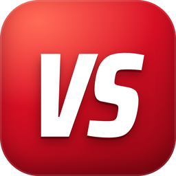
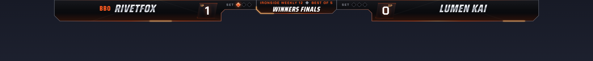
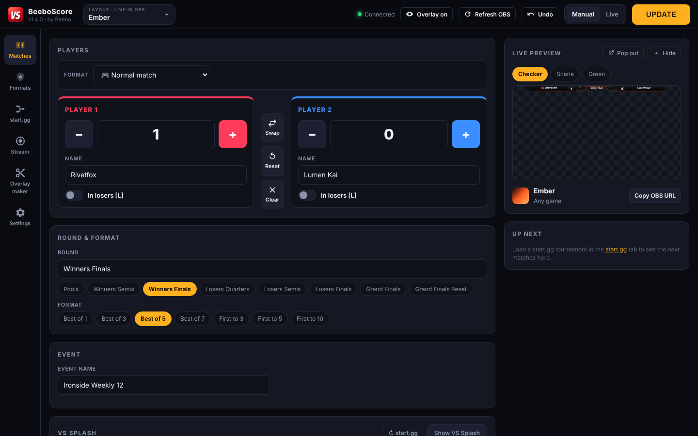
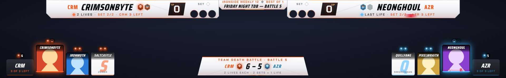
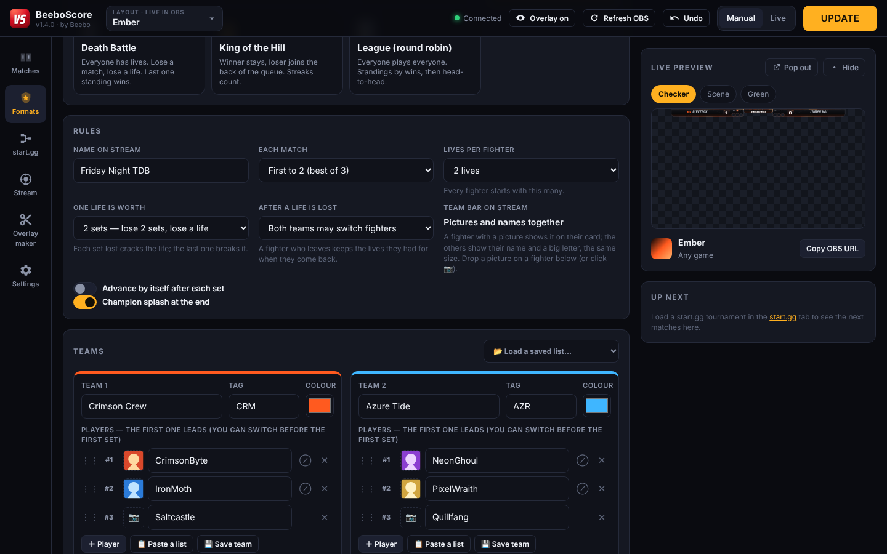
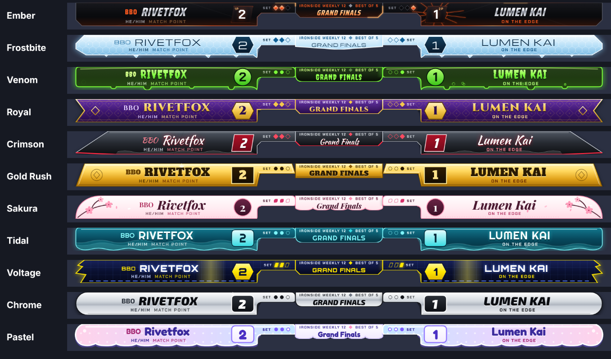
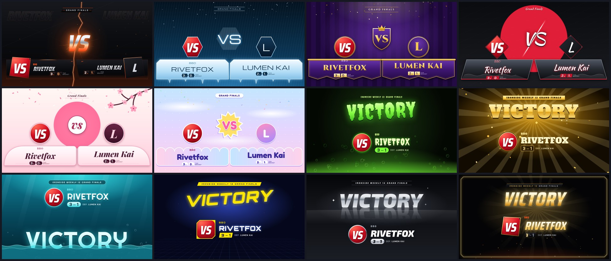
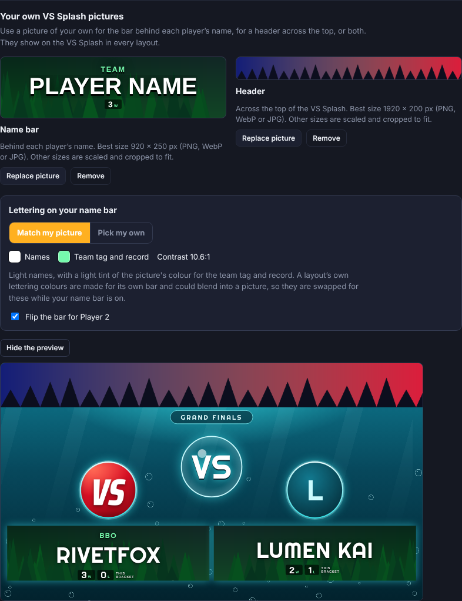
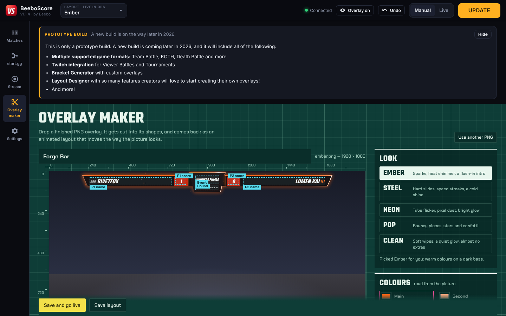

<div align="center">



# BeeboScore

**A free scoreboard overlay for fighting game streams. One exe, no install.**

Developed by Beebo

### [⬇ Download for Windows](https://github.com/t1fgc/beeboscore/releases/latest)

</div>



---

## Windows SmartScreen warning

> [!WARNING]
> The first time you run the exe, Windows may show a blue box that says **"Windows protected your PC"**.
> Click **More info**, then **Run anyway**.

Windows shows this for new apps that not many people have downloaded yet. It does not mean anything was found in the file.

Only click **Run anyway** on a copy you downloaded from this repository's [Releases page](https://github.com/t1fgc/beeboscore/releases). If you got the file anywhere else, delete it and download it here.

---

## Get started

1. Download **`BeeboScore-x.y.z.exe`** from the [latest release](https://github.com/t1fgc/beeboscore/releases/latest) and put it in a folder of its own.
2. Run it. If Windows warns you, see the [SmartScreen warning](#windows-smartscreen-warning) above.
3. In OBS, add a **Browser** source:
   - URL: `http://localhost:3300/overlay`
   - Width `1920`, height `1080`
   - Leave "Refresh browser when scene becomes active" off
4. Type the player names, press **Update**, and the overlay changes on stream.

The app keeps everything it saves in a **`BeeboScore Data`** folder next to the exe. To move it to another PC, move the exe and that folder together.

---

## What's in it



### Matches

Names, scores, round, format and event on one screen. **+ / −** on each score, Swap, Reset, Undo, and a losers **[L]** mark. Changes go live when you press **Update**, or straight away in **Live** mode.

### Game formats



Run an event on top of the scoreboard from the **Formats** tab. The format decides who plays next; you score each set as usual and press **Confirm & next match**.

| Format | How it is won |
| --- | --- |
| **Crew Battle** | Winner stays on. A crew is out when every player has lost. |
| **Team Battle** (Sajam Slam style) | Players are paired by tier. First team to the target points wins; a tie goes to the coaches. |
| **Gauntlet** | One player against a line of challengers. |
| **Team Death Battle** | Two teams, and every fighter has lives. After a life is lost, a team can switch fighters. A fighter who comes back still has the lives they left with. |
| **Death Battle** | Everyone has lives. Lose a set, lose a life. The last one standing wins. |
| **King of the Hill** | Winner stays, loser goes to the back of the queue. |
| **League** | Everyone plays everyone. Standings by wins, then head-to-head. |

Both layouts draw every format in their own style: lives, crowns, tiers or table position on the player bars, a format bar along the bottom, and Board, Team VS and Champion splashes. Knockouts, lost lives, switches and eliminations play by themselves when a result is confirmed. Nothing changes in OBS.

In the team formats, a **lock-in splash** plays when both players are locked in: two halves of glass slide together with each player's picture, name and lives or points, meld, and a light runs down the join. The fighter playing has a bigger card on the team bar, and a fighter on their last life gets a heartbeat across their bar.



To give a player a picture, drop an image on them in the list (or click 📷). A big picture opens a crop window first. The picture is used on their card on the team bar and on the VS and lock-in splashes; players without one show their name and a big letter instead, on a card the same size.

The full guide is in [docs/FORMATS.md](docs/FORMATS.md).

### Layouts

Pick one from the **Layout** menu at the top of the app. It changes in OBS straight away. Both layouts are made for any fighting game and sit in the same place along the top of the screen, clear of the game's timer and portraits. Each player bar covers everything round the game's round-win circles, with a lit rim round each circle.



| Layout | What it is made of |
| --- | --- |
| **Ember** | The original (called Shattered in 1.0.0): dark obsidian with ember light. The winner turns gold and the loser's plate cracks. |
| **Porcelain** | Ember's sister, glazed white, with dark lettering and ember-orange fire. The winner turns gold and the loser's bar shatters and is knocked out of shape. |

Each has an intro, a reaction when a game is taken, a match-point state, a winner and a loser when the set ends, and its own VS Splash and Victory Splash. The score sits in a solid box with at least 7:1 contrast and stays that way for the player who lost. The effects stay off the game's health bars, timer and portraits.

> **The ten elemental layouts** from 1.1.8 (Frostbite, Venom, Royal, Crimson, Gold Rush, Sakura, Tidal, Voltage, Chrome and Pastel) are out for now. They are being reworked and will come back in a later version. If you had edited one, your copy is kept in `BeeboScore Data/data/retired-layouts`.

### VS Splash and Victory Splash

Press **Show VS Splash** on the Matches tab (or **Ctrl + I**) for a full-screen player-vs-player splash before a set. When a set ends, the Victory Splash shows the winner and the final score. Every layout has its own.



### Your own VS Splash pictures

In the **VS Splash** card on the Matches tab you can add pictures of your own. They show on the VS Splash in every layout.

| Picture | Where it goes | Best size |
| --- | --- | --- |
| **Name bar** | Behind each player's name | **920 × 250** |
| **Header** | Across the top of the splash | **1920 × 200** |

PNG, WebP or JPG. A picture of another size is scaled and cropped to fit.

A layout's own lettering colours are made for its own name bar and could blend into your picture. So when you choose a name bar, the app looks at the picture where the names sit and picks lettering that reads on it:

- light or dark names, whichever stands out more
- a tint of the picture's own colour for the team tag and record
- a soft backing behind the lettering when the picture is busy, with a note telling you so

**Pick my own** lets you choose the two colours yourself. If they are hard to read on the picture, the card warns you. **Preview the VS Splash** plays the splash in the card before you put it on stream.



### Splash pictures

On the **start.gg** tab, choose what each player shows on both splashes:

- **Profile picture:** their start.gg profile picture in a small frame. This is the default.
- **Character image:** a picture you upload for that player, shown as a large panel. The small frame is hidden for them.

The best size for a character image is **900 × 1080** (a tall picture). PNG, WebP and JPG all work.

When you choose a picture, a window opens before anything is saved:

- **Crop:** drag the box or its corners to choose the part to keep. It can hold the shape of the splash panel for you.
- **Remove a green screen:** a picture taken in front of a green or blue screen has its background removed. You can pick the colour to remove from the picture, and set how much is removed and how soft the edge is.

The result is saved as a PNG with a see-through background, sized to fit the panel. Your original file is not changed.

To give a picture to someone who is not on the scoreboard, type their name in **Find a player**. Names complete as you type. Pictures are matched to the player's name, so they carry over from event to event.

### Overlay maker

Drop in a finished **PNG** overlay and get an animated layout back.



- Recommended picture: **1920 × 1080 with a transparent background**, or just the scoreboard bar at its real size. PNG only, up to 20 MB.
- The picture is cut into its shapes. Each one gets its own intro, glow, shine and edge light, in one of five looks picked from the picture's colours: Ember, Steel, Neon, Pop or Clean.
- Name, score, round and event text is placed for you. Drag or resize any spot over the live preview.
- Text that's already drawn in the picture can be painted over, so only the live text shows.
- Save it, and it appears in the **Layout** menu at the top of the app. The picture never leaves your PC.

### start.gg

Sign in, load your event, and pull its players and matches onto the scoreboard. Names autocomplete as you type, and results can be sent back to start.gg when a set ends.

### Stream

Copy the OBS link, or press **Go online** for a public overlay link and a password-protected remote control you can open on a phone. It uses a free Cloudflare tunnel; you can also use your own tunnel for an address that stays the same.

### Stream Deck

The plugin comes inside the app: **Settings → Stream Deck → Install** (or **File → Install Stream Deck Plugin**). Then press **Set up my Stream Deck** and BeeboScore fills the whole deck for you: one layout for the 15-key Stream Deck, one for the 32-key Stream Deck XL. On Windows it adds a **BeeboScore Prototype** page to the profile your deck is showing (Stream Deck closes for a few seconds and comes back with it; your other pages stay, and a backup of the profile goes in `BeeboScore Data/data/streamdeck-backups`). On macOS, Stream Deck asks to add the BeeboScore Prototype profile.

The plugin is called **BeeboScore Prototype**. Coming from 1.1.8? Install it from **Settings → Stream Deck**, press **Set up my Stream Deck**, and then remove the old *BeeboScore* plugin in Stream Deck.

- **Top row, the match:** both players' scores at the ends (tap +1, hold −1), Undo, Reset (tap 0–0, hold for a new set) and Swap.
- **Middle, what changes with the format:** each player's keys on their side ([L], or Switch fighter / Forfeit in a format), Next in the middle (next match from start.gg, or confirm & next in a format), then Board, Format bar or Lock in. Format keys are drawn in the format's colour (the same as the Matches tab): Crew Battle orange, Team Battle purple, Gauntlet teal, Team Death Battle pink, Death Battle red, King of the Hill gold, League blue.
- **Bottom row, what is on stream:** Overlay, VS (Team VS in a team format), Victory (Champion once a format is won), Hide all and Refresh. On the XL the last row is left free for your own keys.
- **Undo** takes back a format result when that was the last thing that happened.
- Every key is also in Stream Deck's *BeeboScore Prototype* list to place by hand, including **Format key** (pick the deck and the place in its settings). Needs Stream Deck 6.4 or newer.

**Refresh OBS** (in the header, and on the Stream Deck) reloads the overlay in OBS, cache and all. Through the OBS link the new page fades in over the old one, so there's no visible reload. BeeboScore also does it by itself when the scores are reset to 0–0 and when a new match comes in.

### Settings → Scoreboard

- **Refresh OBS on reset and new match:** the overlay reloads in OBS when the scores go back to 0–0 or the next match comes in. It fades over, with no visible reload.
- **Victory Splash when a set ends:** on, it plays by itself; off, it only shows when you ask for it. **Keep the Victory Splash up for** sets how long it stays (5 to 20 seconds, or until you hide it).
- **Lock-in splash in team formats:** turn it off to skip it.

### Settings → Check for updates

The app only looks for a new version when you press **Check for updates**. (If a newer BeeboScore exe is already in the same folder, it offers that one without downloading anything.) If there is one, **Download update** saves the new exe next to the one you're running, and **Restart & update** switches over to it. After **Restart & update** the app says it is installing, closes, shows a starting screen, and opens again by itself in 10 to 20 seconds. Your `BeeboScore Data` folder is used by both versions, so nothing is lost. Delete the old exe whenever you like.

The first time a new version starts, a **What's new** window lists what changed. You can open it again from Settings.

---

## Your data stays on your PC

- start.gg sign-ins, API tokens, the remote-control password and tunnel tokens are stored encrypted on your PC and are never sent anywhere except to the service they belong to.
- Pictures you drop into the Overlay maker are processed on your PC.
- The app has no analytics or tracking.

---

## Good to know

- **Windows 10 or 11, 64-bit.**
- The app uses port **3300**. If something else is using it, the app picks the next free port and shows it under **Help**; use that number in the OBS link.
- Keep the app open while you stream. OBS shows the overlay from it.
- The overlay looks blank in OBS? Check that the app is running and that the Browser source URL matches the one on the **Stream** tab.

---

## Build it yourself

You need [Node.js 22](https://nodejs.org) or newer.

```bash
npm install
npm start          # run the desktop app from source
npm run server     # or just the server: open http://localhost:3300
npm run dist       # build dist/BeeboScore-<version>.exe
```

More in [docs/BUILDING.md](docs/BUILDING.md). Publishing a release is in [docs/RELEASING.md](docs/RELEASING.md), and changes are listed in [CHANGELOG.md](CHANGELOG.md).

---

## License

[MIT](LICENSE) © 2026 Beebo. The bundled fonts are under the SIL Open Font License or the Apache License 2.0; see [`public/fonts/FONTS-LICENSES.txt`](public/fonts/FONTS-LICENSES.txt).

Found a bug? [Open an issue](https://github.com/t1fgc/beeboscore/issues).
