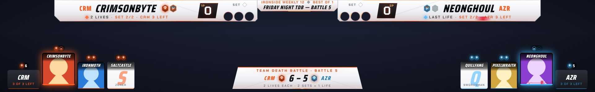

# Game formats

Developed by Beebo. BeeboScore can run seven kinds of event on top of the normal scoreboard: Crew Battle, Team Battle, Gauntlet, Team Death Battle, Death Battle, King of the Hill and League.

Every match inside a format is an ordinary set. The format decides who plays next; you score the set as usual and press **Confirm & next match**.

- [The seven formats](#the-seven-formats)
- [Setting one up](#setting-one-up)
- [Running it from the Matches tab](#running-it-from-the-matches-tab)
- [What shows on stream](#what-shows-on-stream)
- [Team Death Battle, step by step](#team-death-battle-step-by-step)
- [Stream Deck](#stream-deck)
- [Good to know](#good-to-know)

## The seven formats

| Format | How it is won |
| --- | --- |
| **Crew Battle** | The winner stays on and the loser's crew sends its next player. A crew is out when every player has lost. An optional *win limit* retires a player after 2, 3 or 4 wins in a row, so nobody wins it alone. |
| **Team Battle** (Sajam Slam style) | Players are paired by tier, least to most experienced. Each pair plays once and the winner scores a point. The first team to the target wins (a majority by default: 3 of 4). A tie goes to the coaches, to the last pair again, or stays a draw. |
| **Gauntlet** | One player against a line of challengers. The winner stays. |
| **Team Death Battle** | Two teams, and every fighter has the same number of lives (1 to 9). Losing sets costs lives; you choose how many lost sets one life is worth. After a life is lost a **switch window** opens and a team can send in someone else. Every fighter keeps their own lives, so someone who comes back fights on with what they had. A team loses when all its fighters are knocked out. |
| **Death Battle** | Everyone has 1 to 5 lives. Lose a set, lose a life; at 0 you are out and get your placement. The winner stays, or both go back in the queue, or each match is a random draw. The last two play a Final Duel. |
| **King of the Hill** | The winner stays as king and the loser goes to the back of the queue. End it at a streak of 3, 5, 7 or 10, or run it with no target and press **End**: the best record wins. People can join or leave the queue while it runs. |
| **League** | Everyone plays everyone, once or twice. Standings go by wins, then head-to-head, then game difference. Any scheduled match can be played next. |

## Setting one up

Open the **Formats** tab.

1. **Pick a format.** Its rules appear below, each with a line saying what it does.
2. **Set the rules.** Every format has a name for the stream and a length for each match (first to 1 game up to first to 5). The rest depends on the format: lives, win limit, points to win, who fights next.
3. **Fill the rosters.**
   - Type names one at a time with **＋ Player**. They autocomplete from start.gg and from players you have used before.
   - **Paste a list** takes one name per line, or names separated by commas.
   - **From start.gg** (Death Battle, King of the Hill and League) adds the entrants of the event loaded on the start.gg tab.
   - Drag **⋮⋮** to reorder.
   - **Drop a picture on a player** to give them one (or click **📷**). It is used on their card on the team bar (Team Death Battle), on the format's VS Splash and on the lock-in splash. A picture bigger than 1.5 MB or 900 px opens a crop window first, so you choose the part to keep; it is then made smaller for you. **⊘** removes it.
   - Teams have a name, a tag (shown before each player's name) and a colour. Team Battle can also have a coach on each side.
   - **Save team** keeps a roster for next time. **Load a saved list** brings it back.
4. Press **▶ Start**. The first match is loaded onto the scoreboard with both scores at 0, and the app jumps to the Matches tab.

Two switches are on every format:

- **Advance by itself after each set** confirms a won set for you a few seconds after the Victory Splash.
- **Champion splash at the end** shows the winner when the last match is confirmed.

Two more are in **Settings › Scoreboard**, for every format at once:

- **Victory Splash when a set ends.** Turn it off and the Victory Splash only shows when you ask for it.
- **Lock-in splash in team formats.** Turn it off to skip the lock-in splash (see below).

## Running it from the Matches tab

While a format is set up, the Matches tab takes its colour and gains two things.

- **The Format menu** at the top of the Players card switches between a normal match and any format. Names you have typed carry over. Switching while one is running asks first, because its results are cleared (the rosters stay).
- **The console** above the Players card shows the matchup and each side's place in the event: team and players left, the points race, lives, the king's streak, or league position. It has **Confirm & next match**, **Forfeit** (a no-show), **↶ Undo**, the On stream buttons and **End**.

Score the set the way you always do. When someone wins it:

- a green dot appears on the Formats button,
- the console offers **Confirm & next match**.

Confirming records the result and loads the next match. **↶ Undo result** takes the last result back. From anywhere in the app, **Ctrl+Alt+Enter** confirms and **Ctrl+Alt+Z** undoes.

The Formats tab shows the full board while a format runs: both teams or every fighter, the results so far, and **⬇ CSV** to save them.

## What shows on stream

Ember and Porcelain both draw every format in their own style. Nothing needs setting up in OBS: when you pick a format, the overlay reloads itself with the format's pieces, and when you turn formats off it goes back to the plain layout.

| Format | On the player bars | The format bar along the bottom |
| --- | --- | --- |
| **Crew Battle** | Crew colour, the player's place in the crew (#2 of 4), players left, win streak | Both crews' line-ups: who is playing, who is next, who is out |
| **Team Battle** | Tier and the team's points | Tiers, coaches and the points race |
| **Gauntlet** | Stage (3 / 5) and streak | The ladder, one step per challenger |
| **Team Death Battle** | Life crests, *LAST LIFE*, which set of the life this is, fighters left | A card per fighter with their lives on top, and both teams' lives in the middle |
| **Death Battle** | Lives on the bar, and *LAST LIFE* | Survivors with their lives; the fallen with their place |
| **King of the Hill** | The crown and streak on the king's bar, *CHALLENGER* on the other | The king, then the queue |
| **League** | Table position and record | The standings |

- **The format bar** shows or hides with **▁ Format bar** in the Formats tab or the console, or with the Stream Deck key.
- **The VS Splash** becomes the format's own while a format runs: the two players with their place in the event.
- **The lock-in splash** (Crew Battle, Team Battle, Gauntlet, Team Death Battle) plays when both players are locked in: two halves of glass slide in from either side with each player's picture (or a big letter of their name), team, name, and their lives, tier and points, or place in the line. They meet in the middle, meld, and a light runs down the join. About 4 seconds.
- **The fighter playing** has a bigger card on the team bar, lifted a little above the others. A fighter on their **last life** gets a heartbeat line across their player bar and card.
- **Board**, **Team VS** and **Champion** are full-screen splashes, on the On stream buttons.
- **Moments** play by themselves when a result is confirmed: a knockout, a life lost, an elimination with its placement, *NEXT CHALLENGER*, *LAST STAND*, *TIEBREAKER*, *FINAL DUEL*, *NEW KING*.

Layouts you make in the Overlay maker show the format bar, the splashes and the moments too. Their player bars are your own picture, so lives and the other details are not drawn on the bars themselves; the format bar carries them.

## Team Death Battle, step by step

1. In the Formats tab pick **Team Death Battle** and set:
   - **Lives per fighter:** 1 to 9. Everyone starts with the same number.
   - **One life is worth:** how many lost sets take one life. With *2 sets*, the first lost set cracks the life and the second breaks it.
   - **After a life is lost:** *both teams may switch fighters*, *only the team that lost it may switch*, or *nobody switches*.
   - **Team bar on stream:** pictures and names together. A fighter with a picture shows it on their card, with the name on top; a fighter without one shows their name over a big letter of it (and their character under it, when their profile has one), on a card the same size. A big picture opens a crop window when you add it.
2. Fill both teams. The first fighter on each team leads.
3. For pictures, drop an image on a fighter in the list, or click their **📷** button. Any size works: a big picture opens a crop window in the cards' upright shape (720 × 900 or bigger looks best), and the app makes it smaller for you. Their name is drawn across the top of it on stream. You don't need a picture for everyone: fighters without one get a card the same size with their name and a big letter. **⊘** removes it.
4. Press **▶ Start**. The switch window is open before the first set.
5. **To switch a fighter in**, click their button in the switch window on the Matches tab. Each button shows the fighter's lives. **Lock in** closes the window and plays the lock-in splash. The window also closes by itself once the next set has a score, unless that point already wins the set (first to 1): then confirming the result closes it, so the lock-in never lands on top of the K.O.
6. When a set is won, press **Confirm & next match**.
   - A lost set on a life worth 2 sets cracks the crest.
   - A lost life breaks the crest and opens the switch window again.
   - A fighter who loses their last life is knocked out. Their card on the team bar is cut in two and a **K.O.** card takes its place. The team's next fighter comes in with the lives they still have.
7. **＋❤ / −❤** on the board in the Formats tab fixes a fighter's lives by hand.

A fighter who is switched out keeps their lives and any crack. When they come back, they carry on from there.

## Stream Deck

**Settings › Stream Deck › Set up my Stream Deck** puts every key on the deck for you (see the [README](../README.md#stream-deck)). The keys in the middle of the deck are **Format keys**: each one becomes what its place is for in the format that is running, drawn in the format's colour.

| Key | What it does in a format |
| --- | --- |
| **Next** | Confirm & next match. Turns green when a set is won. |
| **Undo** | Takes back the last recorded result when that was the last thing that happened. |
| **Board / Format bar / Lock in** | Shows or hides the Board splash or the format bar; in Team Death Battle's switch window, locks the fighters in. |
| **Switch fighter** | Team Death Battle, one per team on that player's side. Shows the team's fighter and their lives; after a life is lost, press to send in the team's next fighter. |
| **Forfeit** | Hold to record a no-show for that side. |
| **VS / Victory** | Team VS during a team format; Champion once a format has been won. |

Every key is also in Stream Deck's *BeeboScore Prototype* list to place by hand.

## Good to know

- **One format at a time.** Picking another format while one is running clears its results. The rosters stay.
- **Formats are saved.** If the app closes in the middle of an event, it is still there when you open it again.
- **Results are not sent to start.gg.** A format's matches are its own; start.gg reporting is for sets loaded from the start.gg tab.
- **Joining late** works in King of the Hill only. A Death Battle's fighters are fixed once it starts.
- **Pictures stay on your PC**, in the `BeeboScore Data` folder.
- Player names in this guide and in the screenshots are made up.
