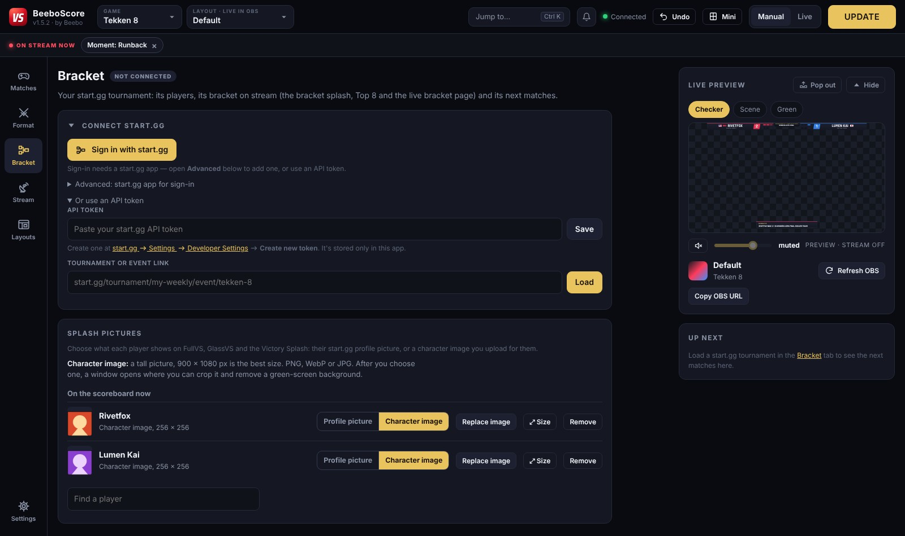
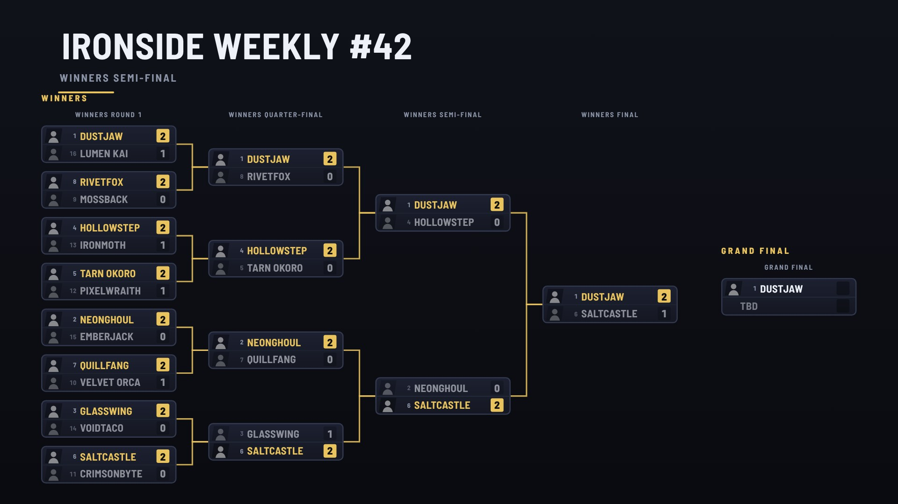
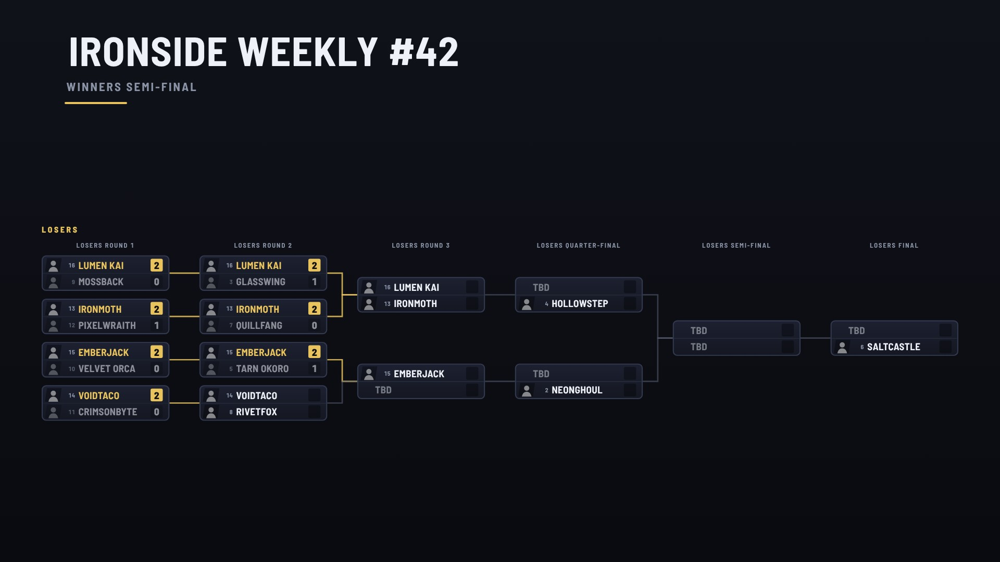
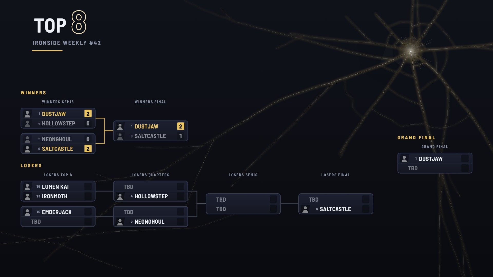

# start.gg brackets

[← BeeboScore guide](../GUIDE.md)

## start.gg

**Sign in with start.gg** (Bracket tab). It opens start.gg in your own browser; if you're already signed in there, it's one click. Then:
- **My tournaments** appears next to it: every tournament you organise or help run. **Pull players** loads one as your tournament, its players fill the name autocomplete, and its bracket feeds the splash. Events with more than one game get a picker.
- **Sign out** deletes the saved sign-in from this PC.
- **Security:** sign-in uses start.gg's OAuth with a one-time random code check. BeeboScore only listens for start.gg's answer on this PC (127.0.0.1), for that one sign-in, for at most 5 minutes. The tokens never reach the panel or any browser. They're stored encrypted: Windows protects them (DPAPI), and copies outside the desktop app use AES-256-GCM with a key only your user can read. They refresh themselves.
- **Setting up sign-in (once, by whoever builds BeeboScore):** create an OAuth application at start.gg › Developer Settings with the redirect URL `http://127.0.0.1:53719/startgg/callback`. Then either paste its Client ID and Secret under **Advanced: start.gg app for sign-in**, or put them in `startgg-oauth.json` (`{ "clientId": "…", "clientSecret": "…" }`) next to the app when building. If start.gg only accepts https redirect URLs, host `docs/startgg-callback.html` (for example on GitHub Pages) and use its address as the redirect URL in both places. It hands the code straight back to the app.

**Or use an API token:**
1. On start.gg go to **Settings → Developer Settings → Create new token** and copy it (tokens can only be viewed once and last a year).
2. Paste it under **Or use an API token** and click **Save**. It's stored only in the app's data folder.
3. Paste your tournament link (or event link) and click **Load**. Pick the event if there's more than one.

**Unload**, beside Load, takes the tournament out of the app — its event, players and bracket — and keeps your start.gg sign-in or token. The show log notes it; **Load** brings it back.

The app then:
- imports every entrant (gamer tag, sponsor prefix, country, pronouns) for **autocomplete**,
- lists the event's open matches under **Bracket** (in progress first), and your **Stream queue** if you assign matches to a stream on start.gg,
- **Load** on a match fills both players and the round name. Press Update and you're live.

Tick **Auto-refresh** to keep the match list current. Use **Refresh** next to the player count if people register late.

**One-click report:** each open match in the list has a **✓** next to both names: click the winner's and the set is reported to start.gg (with **Undo** in the message that pops up). **Disqualify a player** (under the match list) DQs them from their next match. **List / Bracket:** switch the match list to a **bracket view** with every round in columns and lines to the next match; it remembers your choice. Viewer tournaments have the same ✓ and bracket view on the bracket dashboard.

### Results back to start.gg

When a match you loaded from the start.gg bracket ends, BeeboScore can report it to start.gg for you: the winner and every game in the right order (the winner takes the last one). Pick the mode on the **Results to start.gg** card (Bracket tab):
- **Ask** (default): the win card on the Matches tab gets a **Report 3–1 to start.gg** button.
- **Automatic:** sent by itself 10 seconds after the set is won, so a mis-click fixed in time is never sent.
- **Off:** you report on start.gg yourself.

The card lists what was sent, with **Undo** (which resets the set on start.gg). Results that can't go out straight away (the internet drops, start.gg is busy) wait and retry every 30 seconds. Reporting needs an account that is an admin or reporter for the tournament; if you signed in before this version, **sign out and in again** once so start.gg grants it. There's a **Report result to start.gg** Stream Deck key too.

**Stations:** a station you assign to a match on start.gg shows on the live bracket page (*STATION 3*) and in `!next` answers.

### Bracket and Top 8 splashes

| Winners side | Losers side | Top 8 |
|---|---|---|
|  |  |  |

**The Classic layouts** use the app's own bracket splash, Top 8 splash and final standings. The buttons, shortcuts and Stream Deck keys work the same in every layout.

The bracket splash's title is **Tournament Bracket** (or your own name, under *Bracket title*) with how many players are still in. "Top" is only used once the event reaches its Top 8.

**Bracket › Bracket splash** puts the loaded event's bracket on stream, full screen, in the obsidian-and-ember style:
- It **builds itself from start.gg** for any size up to **48 players**. Winners and losers share one screen up to about 16 players; bigger brackets show a **Winners** page and a **Losers** page that take turns (see below). Byes are left out. Past 48 players the earliest rounds are dropped so it still fits.
- **Winners and Losers sides:** brackets too big for one screen show a **Winners** page and a **Losers** page. *Switch to the other side* sets how long each side stays up (8, 14 (default), 20, 30, 45 or 60 seconds), or *only when I switch*. **On screen: Winners / Losers** jumps to that side right away and restarts the timer; if the bracket isn't on stream, it brings it up on that side. Every overlay (OBS and online links) turns the page at the same moment. There's a Stream Deck key and an optional keyboard shortcut for it too.
- **Keeping it current:** while it's showing, results refresh automatically every 10, 20 (default) or 45 seconds, or never (pick under *Auto-refresh while showing*). **Refresh now** (or the **Refresh bracket** Stream Deck key / keyboard shortcut) fetches the latest results immediately, and *Updated N s ago* shows how fresh it is.
- The match on stream (loaded from start.gg) is marked **ON STREAM** and shows the live scoreboard score; the next match in your stream queue is marked **UP NEXT**.
- Animations: the columns ignite one after another, names decode in, finished paths burn in with sparks running along them, a reported result flares and sends a spark to the next match, and it cracks apart when hidden.
- **Top 8:** once all eight players in the Top 8 are known (winners semis and losers round of 8), the bracket switches to the **Top 8 splash**: a darker storm design with big player cards and start.gg profile pictures. It opens with a lightning strike, the TOP 8 title slams in and cracks, the cards drop in with an electric jolt, faint lightning flickers in the background, the match on stream crackles with red electricity, and results arc a bolt to the next match. **Show Top 8** brings it up any time; untick *Switch to the Top 8 splash automatically* to keep the full bracket.
- **Loading a new tournament or event** fetches its bracket straight away and gives every open overlay a fresh page load, so nothing from the previous bracket can stay cached in OBS. Overlay scripts are also stamped with the app version, so OBS always picks up new ones after an update.
- If the event has several pools or phases, it picks the latest one in play; choose another under **Pool**.
- **Going on air:** showing the bracket or Top 8 first fetches the latest results (usually a second or two; the button and Stream Deck key say *Loading…*), so it opens once with fresh data. Results that arrive during an animation are applied when it settles.
- Only one full-screen splash shows at a time: the VS Splash, the bracket or the Top 8.
- A layout can opt out with `<meta name="sb-bracket" content="off">`; `<html>` gets the class `sb-bracket-on` while it's showing.

### Top 8 results picture

When a start.gg bracket finishes, BeeboScore asks (bottom right of the app) whether to make a **Top 8 results picture** for socials. **Customise it** opens the maker:

- **A character picture for each player:** drop one on their row (or click the square). Best size **600 × 720 px** (5 : 6), a PNG with a see-through background — it stands on the player's name, above it. A player with a saved character image (Splash pictures) starts with it.
- **Shape:** Landscape 1920 × 1080 (X, YouTube, Discord), Portrait 1080 × 1350 (Instagram feed), Square 1080 × 1080, Story 1080 × 1920 (TikTok, Reels, Stories), or your own size (600 to 4096 px a side).
- **Colours:** your layout's, on a background made to stand out in a feed: two big glows, panes of glass, a ghost *TOP 8*. Change the title if you like.
- **💾 Save to BeeboScore's folder** (the `top8-results` folder in BeeboScore's data folder) or **⬇ Save as…** to put it anywhere. **📂 Open the folder** shows the saved ones.

### Share & export

The **Share & export** card in the Bracket tab:

- **Live bracket page for viewers.** Turn it on and you get a secret link (`/watch/…`) to post in chat or on socials. The page shows the bracket and updates by itself every few seconds, marks the match on stream, and has a **Find yourself** box: viewers type their name to see if they're still in, who they play next, or the place they finished. It works on phones and follows the phone's light / dark setting. Updates arrive the moment they happen (one open connection per viewer, with a fallback to checking every few seconds). It's **view only**: the link only ever reads public bracket data (names, scores, placements). Nothing on it can change anything, it can't reach the rest of BeeboScore, and the link is long and random so it can't be guessed. Turning it off kills the link at once; turning it on again makes a new one. People outside your network need you to be **online** (Stream tab); otherwise it works for anyone on your network.
- **`<Tournament name> bracket.html`.** The same page is saved as a single file named after the tournament, to send to people. It pulls live results from the link while it's alive and falls back to the last results written into it. With a quick online link the address changes each time you go online, so files you already sent stop updating then — use your own Cloudflare tunnel (Stream tab) for an address that never changes.
- **Other pools:** when a start.gg phase is split into pools, the live page also shows the other pools (tabs at the top, and **Find yourself** searches them all). They load in the background while the page is shared.
- **Full standings** on the live page once it's over — the Top 8, and **Show all** for every placement start.gg has.
- **Top 8 standings splash:** 1st place big with a crown, 2nd–4th, then 5th–8th, in the Top 8 storm style. The placements come from start.gg's own final standings. **Show on stream** (or the **Top 8 standings** Stream Deck key) puts it up any time; *When the tournament ends…* shows it by itself at the end. **PNG / JPG** save it as a 1920 × 1080 picture and a **1080 × 1080 square** (Instagram) for social media (desktop app); at the end it saves them by itself. **Copy post text** copies a ready-made post with the Top 8.
- **Pictures:** pick **Profile pictures** (start.gg) or **Character art** for the bracket, the Top 8 and the standings. Character art uses the character pictures in BeeboScore's picture library, named after the character (e.g. `Lynx.png`). Players without one show their character's name, and players with no character show their profile picture. In the bracket, pictures appear when the match boxes are big enough. **Import character art folder…** takes a whole folder at once: every picture is added to the library tagged *character* (a newer picture of the same character replaces the old one). `Lynx.png` and `Lynx Ardent.png` both match a player on Lynx.
- **Open folder** opens the folder with this tournament's files.
- **The files are temporary.** The live link stops working and the page file is deleted **15 minutes after the tournament ends**, so viewers can still see the final results for a bit. The pictures stay until you delete, restart or replace the tournament, and at most 24 hours after it ended, so save them somewhere else to keep them. Your start.gg event and your viewer tournament keep their files side by side, so switching between them doesn't delete anything; a new event (or a new viewer tournament) replaces the old one's files, **Delete these files now** removes them straight away, and leftovers are cleaned up when BeeboScore starts.

---

[Install & OBS](install-and-obs.md) · [Running matches](matches.md) · [Game formats](formats.md) · [start.gg brackets](brackets.md) · [Layouts](layouts.md) · [Stream Deck](stream-deck.md) · [Going online](online.md) · [Settings](settings.md) · [Building](building.md) · [Troubleshooting](troubleshooting.md)
