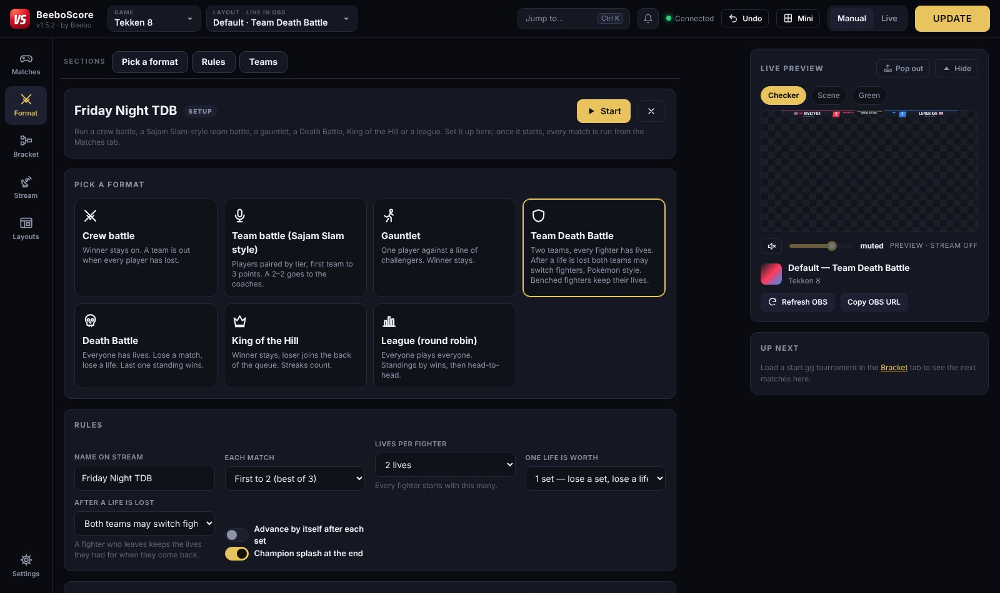
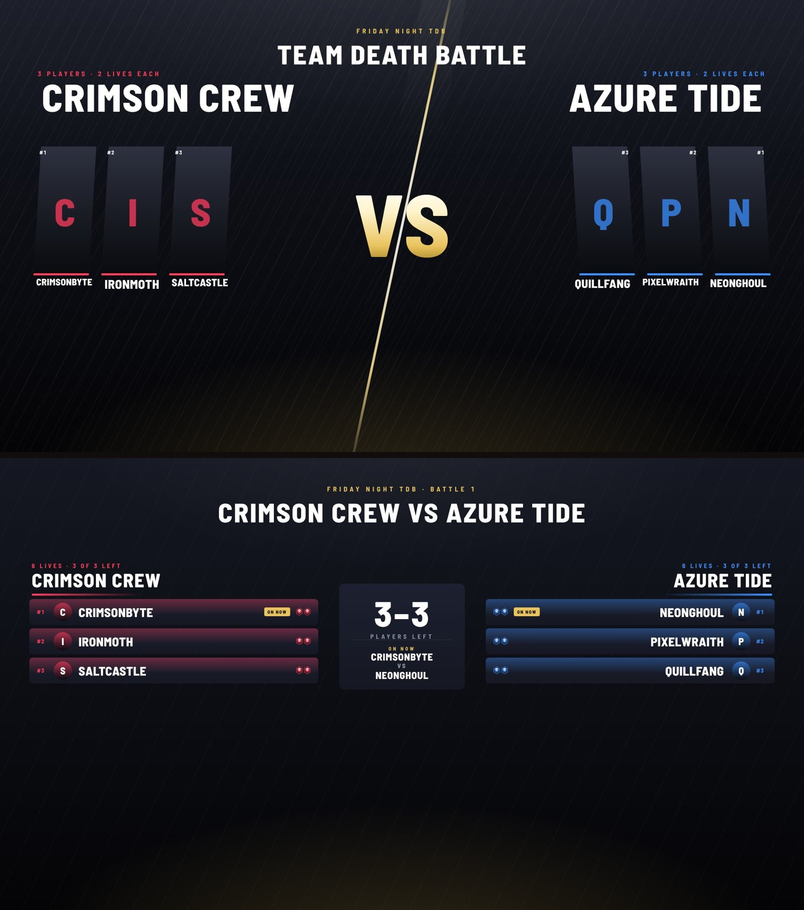

# Game formats

[← BeeboScore guide](../GUIDE.md)

## Game formats: team battles, Death Battle, Team Death Battle, King of the Hill, leagues

Set a format up in the **Format** tab; once it starts, you run it from the **Matches** tab.

- **Change the format from the Matches tab.** The **Format** menu at the top of the Players card switches between a normal match, Crew battle, Team battle, Gauntlet, Team Death Battle, Death Battle, King of the Hill and League. Names you already typed carry over. Switching while one is running asks first (its results are cleared, rosters stay). Rosters and rules are still set up in the Format tab (**Set up in the Format tab**).
- **The bottom of the screen looks like the scoreboard.** The PlayerCards, the team boxes and the middle header — and the name rows on the format's splashes — are made like your layout's player bars: the same glass (Obsidian Glass), glaze (Porcelain) or card (Default), the same slanted ends and the same lettering, with the team's colour as a stripe. Every name fits whole: it gets smaller first, then (a very long one) goes onto two lines where it breaks naturally — never cut off with "…".
- **The Matches tab takes on the format.** It's tinted in the format's colour (orange crews, purple team battle, teal gauntlet, pink Team Death Battle, red Death Battle, gold King of the Hill, blue league) and a console above the players shows the matchup with each side's context: team, stock and players left, the points race, Death Battle hearts with **−/ ＋**, the Team Death Battle switch window, the king's crown and streak, league position. **Confirm & next match**, **Forfeit**, **↶ Undo**, the board and Team VS splashes, the format bar and **End** are all there. **Board** opens the full board in the Format tab.
- **Starting a format jumps to the Matches tab**, wherever you pressed Start.
- **Manage the players in the Format tab.** While a format runs, the Format tab shows a player manager for it: every life, point, win and loss is a button (＋ / −), and you can knock a player out or bring them back, move them up or down the line-up, put anyone in the match now (**▶ Play now**), and in a league record or clear any result. The score strip at the top is the Matches tab's score, so scoring there or here is the same thing, and the format follows it.

| Format | How it's won |
| --- | --- |
| **Crew battle** | Winner stays on; a team is out when every player has lost. Optional *win limit* retires a player after N wins in a row, so nobody wins it alone. |
| **Team battle (Sajam Slam style)** | Players paired by tier (least to most experienced), first team to the target points (majority by default — 3 of 4). A tie goes to the coaches (or the last pair again, or a draw). |
| **Gauntlet** | One player against a line of challengers, winner stays. |
| **Team Death Battle** | Two teams, every fighter has the same number of lives (1–9). Losing sets costs lives — you choose how many sets one life is worth (1 set, 2 sets…). After a life is lost, a **switch window** opens and either team can send in someone else, Pokémon style (or only the losing team, or nobody). Every fighter keeps their own lives, so someone who comes back fights on with what they had left. A team is out when all its fighters are knocked out. |
| **Death Battle** | Everyone has 1–5 lives. Lose a match, lose a life; at 0 you're eliminated and get your placement. Winner stays, queue order or random draw. The last two play a Final Duel. |
| **King of the Hill** | Winner stays, loser goes to the back of the queue. Win at a streak (3, 5, 7, 10) or run it with no target and press **End**. People can join or leave the queue while it runs. |
| **League** | Everyone plays everyone (or twice). Standings by wins, then head-to-head, then game difference. Click any match to play it next. |

1. **Pick a format**, set its rules, and fill the rosters: type names (they autocomplete from start.gg and past players), **Paste a list**, **From start.gg** (Death Battle / KOTH / league), or **Load a saved list**. Drag ⋮⋮ to reorder. Teams have a name, a tag (shown before each player's name), a colour and, for Sajam-style battles, a coach. **Save team** keeps a roster for next time.
2. **▶ Start** loads the first match into P1 / P2 (scores at 0, round label and best-of filled in) and offers to switch to the matching layout.
3. **Score the set as usual.** When someone wins, the Format tab (and a green badge on its rail button) asks you to **Confirm & next match** — or turn on *Advance by itself after each set*. You can also record a win, a **forfeit** (no-show), **▶ now** (swap who plays next), **＋** (give a life back), or **✕** (leave the queue). **↶ Undo result** takes back the last result. Ctrl+Alt+Enter confirms and Ctrl+Alt+Z undoes from anywhere in the app.
4. **On stream:** **Team VS**, **Board** (both crews, the Death Battle board, or the standings) and **Champion** (shown by itself when it ends). **CSV** exports every result (and the standings).

**On stream.** Pick a format and the layout switches to that format's version of your look (Tekken 8's Classic has a version for each format; the other games run formats on their base layout). Each format has its own pieces:

| Format | On the player bars | The format bar (bottom) | Its VS screen |
|---|---|---|---|
| **Crew Battle** | Crew colour, the player's stock (#2 of 4), players left, win streak | Both crews' line-ups: who's playing, who's next, who's out; *4 – 3 players left* | Crew vs crew: stock as shards under each name, players left |
| **Team Battle** | Tier and the team's points | Tiers, coaches and the points race (first to 3) | A tier medallion, both teams' points, every tier matchup |
| **Gauntlet** | Stage (3 / 5) and streak | The ladder: each stage as an arrow, cleared stages dark | Stage badges and the whole ladder |
| **Team Death Battle** | **Life crests** (original hex gems: full, cracked when a 2-set life is half gone, empty with an X when lost), *LAST LIFE*, *SET 1/2*, fighters left | Both teams' fighters as cards with **their lives on top**: their picture or clip with the name across it, or the name. The middle shows each team's lives left and when the switch window is open | Both line-ups with their crests |
| **Death Battle** | **Lives right on the bar**, and *LAST LIFE* | Survivors with their lives, the fallen with a skull and their place | Lives as big gems, *4TH PLACE ON THE LINE* when it's someone's last life |
| **King of the Hill** | The crown and streak on the king's bar, *CHALLENGER* on the other | The king, then the challenger queue | The king with the crown and streak, the challenger, who's next in line |
| **League** | Table position and record | The standings | Both players' records and a mini table |

- **Team names, no tags** (1.11): a team has a name and a colour; the name shows on the player bars, the team bar, its score box and the Stream Deck keys.
- **Any number of players** (1.11): the team bars shrink to fit their half of the screen (names get smaller before they're cut, and stay centred), so they never run under the score box.
- **Knocked out** (1.11): a team player's card takes a hit, a web of cracks spreads from the impact in the team's colour, and after a beat it bursts into glass that falls away.
- **The format bar** shows or hides with **Format bar** in the Format tab, the **Format: Bar** Stream Deck key, or the OBS dock.
- **Every life counts.** When a Death Battle fighter loses a life, the bar holds on them for a moment. The gem tears off the bar, swells and bursts, cracks run through the bar, a big counter drops (3 → 2), and *−1 LIFE* stamps beside it. The first, second and third life lost each break differently. On the last life the bar beats like a heart until the next fight. An elimination breaks the whole bar apart with *ELIMINATED* and the placement. A crew knockout cracks and bursts the bar with *K.O.*, then *NEXT CHALLENGER* slashes in.
- **Team Death Battle moments.** A lost set on a 2-set life cracks the crest. A lost life breaks it (*−1 LIFE*) and the team bar's counter drops. When a fighter loses their last life, their card on the team bar is slashed in two, the halves fly apart and a **K.O.** card drops in with *KNOCKED OUT*. Switching someone in plays *SWITCH IN*.

### On stream

- **The format bar** changes piece by piece. With five or more a side, each side fits its own width: pieces get narrower and names smaller, and what still doesn't fit folds into a **+N** piece (the knocked-out first). The fighter playing has a bigger card that floats gently. Names are centred.
- **Lock-in splash** (Crew Battle, Team Battle, Gauntlet, Team Death Battle): when both players are locked in, two halves of tinted glass slide in, one per player, with their picture or initial, team, name and lives or tier. They meet with a flash down the join and lift away. Turn it off in Settings › Scoreboard. **GlassVS:** put it up yourself with **Format › ⚔ GlassVS** or the **Format · GlassVS** Stream Deck key; then it stays until you hide it, even with the automatic one off in Settings. While a team format runs, the **VS Splash** button in the Matches tab and the VS Splash key become Show / Hide GlassVS, and **Hide all** takes it down.
- **Lives are per fighter:** give a fighter more lives than the format's number in the player manager and every crest shows, on the bar, their card and the splashes.
- **Last life:** a heartbeat line crosses the fighter's bar and card, and a faint one keeps running along the foot of their card while their last crest beats red.
- **Names wipe in** out of a soft blur during a format; nothing scrambles.
- **Pictures:** drop any picture on a player, up to 60 MB. The picture window opens: crop it, size it, and take the background out automatically or a green screen, with previews of the player card and GlassVS. Then it's made smaller on this PC (at most 900 px, WebP). A picture smaller than 200 × 240 skips the window.

### Names, PlayerCards and pictures

- **Names:** two players in a format can't have the same name (case and spaces don't count). The second one turns red in the roster and **Start** waits until every name is different; someone joining a King of the Hill with a name that's already in is turned away.
- **PlayerCards** is the name for the player cards along the bottom of the layout. In team formats they take a wash of their team's colour, and the box in the middle blends one team's colour into the other's. The player bars at the top take their team's colour too, and their own effects (the light flow, the sheen, the cracks) run in it. Death Battle does the same with each fighter's colour. **Settings › Scoreboard › Format bar see-through** sets how solid their background is.
- **Team boxes** (bottom corners): the name sits in the middle, and the lives above it are bigger. Add a **team logo** in the roster (the small square beside the team colour: a square PNG with a see-through background, 256 × 256 or bigger; right-click to remove): it goes in the box with the name above it, and the box grows to fit.
- **Team Death Battle and Death Battle** look the same: crests for lives on every card, the cards' effects (a life lost, the last-life heartbeat, a knock-out, a switch-in) stay inside the card they belong to, and a knocked-out card says **K.O.** over the picture, clear of the name.
- **GlassVS** (the lock-in splash): each player's picture sits whole in a frame of its own, with nothing dark over it, and the name and lives under it. It works in any match now, formats or not: **Format › ⚔ GlassVS**, the GlassVS key, or pick **GlassVS** beside the VS button in the Matches tab. **FullVS** is the regular VS splash.
- **Picture size:** the **⤢** beside a player's picture sets how big it is and where it sits — once for **FullVS, GlassVS and the PlayerCards**.

### King of the Hill: the leaderboard and the records

- **The king's card** on the bar is a size up, with a gold rim and a glow round it. Every ten wins in a row it burns hotter: **×10** a light runs round the rim, **×20** flames lick up over the card, **×30** and on the rim goes white-hot, sparks rise and the flames grow every ten. Each ×10 milestone gets a moment of its own across the screen.
- **Leaderboard splash** (**Format › 🏛 Leaderboard**, the Stream Deck's Leaderboard key, any time): **King of the Hill** — this event, by wins, starting over every time an event starts — beside **Emperor of the World**: everyone since the first King of the Hill event, by wins, top 10, with their best streak and how often they were crowned. It updates live as each fight is recorded.
- **Records** (Format tab, King of the Hill records card): kept on this PC in BeeboScore's data folder as `koth-records.json` (the record, and what a backup holds) and `koth-records.csv` (a sheet of every player since the first event, rewritten after every fight — opens in Excel, Google Sheets or Numbers). **⬇ Backup**, **⬇ Sheet**, **⬆ Restore a backup** (merge it in or replace), **📂 Open folder**, and **Reset records**. An undone fight is taken back from the records too.

### Team Death Battle, step by step

1. In the Format tab pick **Team Death Battle**. Set **Lives per fighter**, **One life is worth** (how many lost sets take one life — the panel explains what that means), **After a life is lost** (*both teams may switch*, *only the team that lost*, or *no switching*).
2. Fill both teams. Each player has a square next to their name for **their own picture or clip** (optional, every format): drop a PNG / WebP / JPG, a GIF, or a WebM / MP4 clip on it, or click it. Best: square, 256 × 256 or bigger (512 × 512 is sharpest); clips up to 6 seconds, under 8 MB. A clip filmed on a green screen has the green taken out on its own (the square says **KEYED**; click it to keep the green). Right-click the square to remove the picture. It shows on their card on the team bar and on the VS Splash when they're up.
3. **▶ Start.** The switch window is open before the first set: in the Matches tab, click a fighter's button to send them in (or use **🔄 in** in the Format tab, or the **Format · Switch fighter** Stream Deck key). **Lock in** (also a Stream Deck key, in the main layout's Team Death Battle row) closes the window; it also locks by itself once the set has a score. **Locked in too early?** **↩ Undo lock-in** in the Format tab or the Matches tab opens the window again — or press the Stream Deck's **Lock in** key again (it says *PRESS TO UNDO* while it can). That works until the next set is recorded, and it won't lock itself again just because a score is already up.
4. When a set is won, **Confirm & next match**. A fighter on their last life who loses is knocked out and the team's next fighter comes in with whatever lives they still have. **＋❤ / −❤** fixes a life by hand.

- **Bands and splashes:** *NEXT CHALLENGER*, *LAST STAND*, *TIEBREAKER*, *FINAL DUEL*, *NEW KING*, and the board / Team VS / champion splashes, all in the style of the look you're using.

- **Team VS and Team Board look nothing alike.** **Team VS** splits the screen between the two teams: each team's name big on its side and its line-up standing as tall portraits facing the other team's, a bright seam between them and **VS** on it. **Team Board** is a roster table: a row per player with a round picture, their character and record or lives, *ON NOW* or *OUT*, and the score with who's on now in the middle. Both use each player's own picture (their character's art if they have none, else their initial).
- **PlayerCards follow the character.** When a player picks another character, type it in the Matches tab's **Character** box (or in the Format tab's player manager, next to their name — it suggests the Tekken 8 roster). If your character art has a picture for that character (**Bracket › Share & export › 🗂 Import character art folder…**, pictures named after the characters — Reina.png, Jin.png…), their card on the format bar switches to it straight away, with a quick flash; a character without art keeps their own picture.
- Every layout shows the format splashes.

---

---

[Install & OBS](install-and-obs.md) · [Running matches](matches.md) · [Game formats](formats.md) · [start.gg brackets](brackets.md) · [Layouts](layouts.md) · [Stream Deck](stream-deck.md) · [Going online](online.md) · [Settings](settings.md) · [Building](building.md) · [Troubleshooting](troubleshooting.md)
