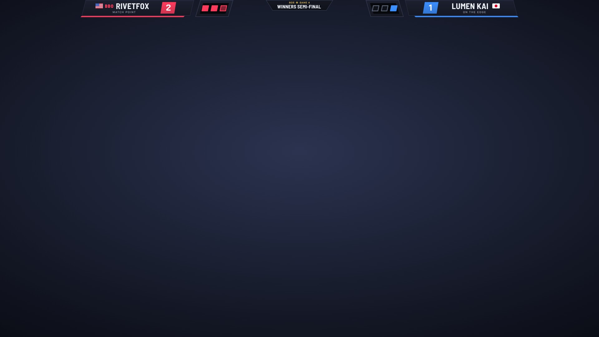
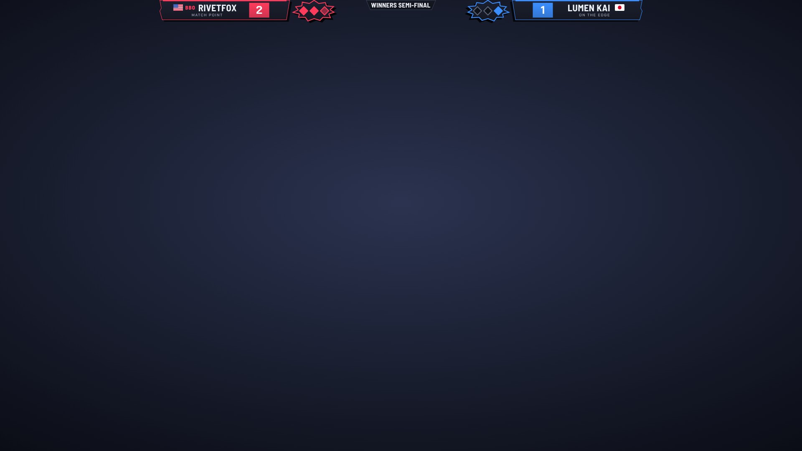
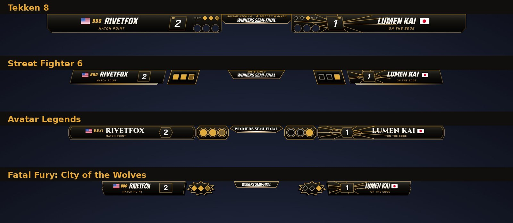
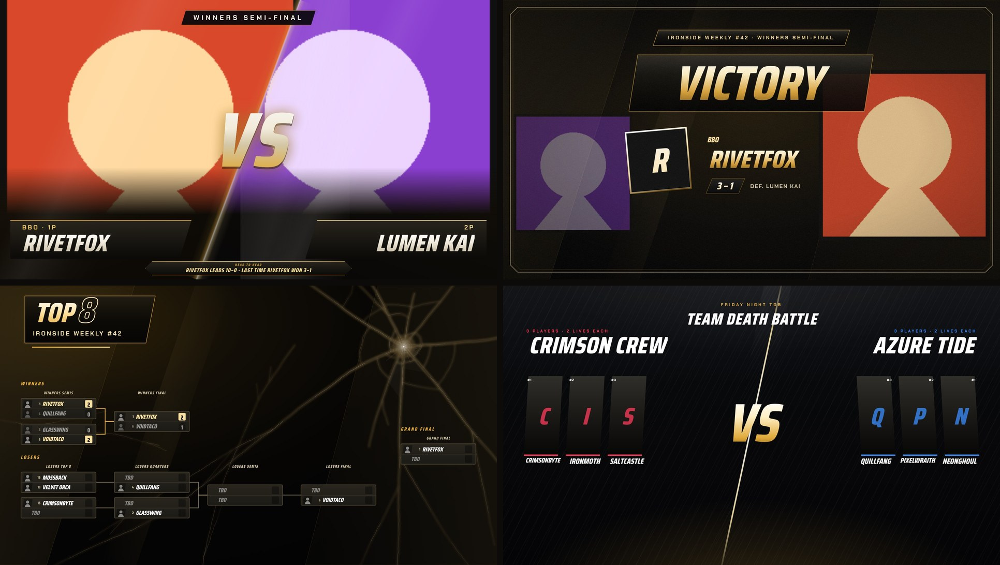
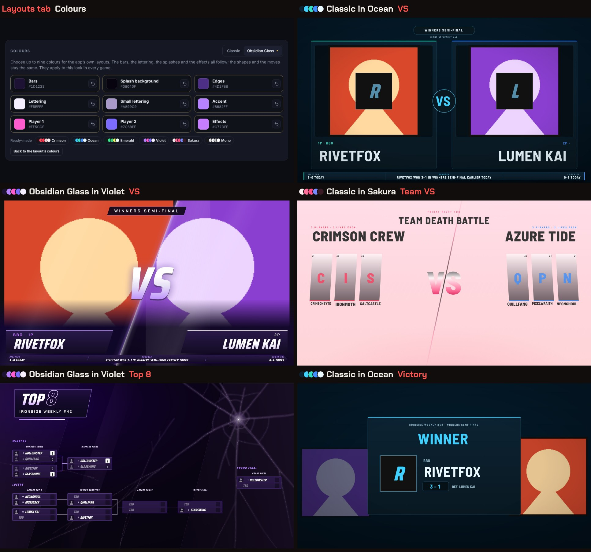
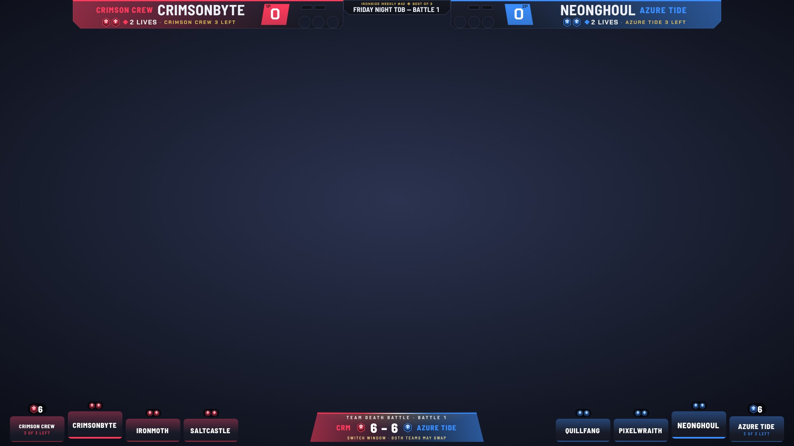

# Layouts

[← BeeboScore guide](../GUIDE.md)

BeeboScore comes with two layouts for each of its four games: **Classic** and **Obsidian Glass**. Pick one from the **Layout** menu at the top of the app (and give either one your own colours on the **Layouts** tab, see [below](#your-own-colours)); with **Settings › Scoreboard › Follow the game** on (the default), changing the game switches to that game's layout by itself.

Layouts you import (or make) on the **Layouts** tab sit in the same menu, under the game they're for. See [your own layouts](your-own-layouts.md).

| Game | Layout | Where the scoreboard sits |
|---|---|---|
| **Tekken 8** | Classic (`tekken8-default`) | Along the top, around the game's round counters |
| **Street Fighter 6** | Classic (`sf6-default`) | Along the top, above the health bars: slanted plates, a slanted set box |
| **Avatar Legends** | Classic (`avatar-default`) | Along the top, above the health bars: Art Deco plates, a round window for each lamp |
| **Fatal Fury: City of the Wolves** | Classic (`fatalfury-default`) | Along the top, above the health bars: comic-book plates and a burst for the set count |
| **Every game** | Obsidian Glass (`tekken8-obsidian`, `sf6-obsidian`, `avatar-obsidian`, `fatalfury-obsidian`) | With the bars where that game's Classic has them, in black obsidian glass and antique gold |

| Tekken 8 | Street Fighter 6 |
|---|---|
|  |  |
| **Avatar Legends** | **Fatal Fury: City of the Wolves** |
|  |  |

### Obsidian Glass

Black obsidian glass and antique gold, with the bars where each game's Classic has them. The lettering is italic, cracks spread from the score as a player falls behind (a comeback mends them), embers rise off a plate on a winning streak, and at the end of the set the loser's plate shatters like glass. It moves with a snap and a little overshoot. The VS and Victory splashes are full-screen dark glass and gold, its own Top 8, bracket and standings screens are in the same glass, and the game-format splashes wear it too. On Tekken 8 the sets won show as diamonds by the word SET, and Tekken 8's Obsidian Glass has a version for each game format, like Classic.

When **Follow the game** is on, changing the game keeps the look: Obsidian Glass on Tekken 8 becomes Obsidian Glass on Street Fighter 6.

### Your own colours

The **Colours** card at the top of the **Layouts** tab recolours the app's own layouts. Pick the look with the switch on the right of the card (**Classic** or **Obsidian Glass**), then click any of the nine swatches:

| Part | What it colours |
|---|---|
| **Bars** | The plates, boxes and cards: the scoreboard's bars, the header, the bracket and standings rows, the format bar |
| **Splash background** | The background of the VS, Victory, Top 8, bracket, standings and game-format splashes |
| **Edges** | Borders, outlines and dividing lines |
| **Lettering** | Names, scores and titles |
| **Small lettering** | Labels, rounds, team tags and other small text |
| **Accent** | The look's highlight: the winner, the round, match point (gold on both looks as they come) |
| **Player 1** | 1P's colour: its stripe, score box and VS side |
| **Player 2** | 2P's colour, the same way |
| **Effects** | Particles, sparks, flashes, glows, embers and the moves' trails |

Only the parts you change move; every shade of a part moves with it, so a bar's darker edge stays darker and a glow stays a glow. The shapes, the lettering style and the moves stay the same, so Classic still looks like Classic and Obsidian Glass still cracks and shatters. Choose a dark **Lettering** colour and the white lettering turns into it, so a light set like Sakura still reads. On the full-screen screens (VS, Victory, Top 8, the bracket, the standings and the game-format splashes), lettering in a pale shade, like a gold title or a cream line, is drawn a deeper shade so it stands out from the light plates too.

- **Ready-made** gives you six full sets to start from: Crimson, Ocean, Emerald, Violet, Sakura and Mono. Pick one, then change any part you like.
- A part you've changed has a dot and its own **↺** to put just that part back. **Back to the layout's colours** puts all nine back.
- The colours belong to the look, not the game: Classic in your colours is Classic in your colours on all four games (and Tekken 8's game-format versions). Classic and Obsidian Glass each keep their own.
- OBS picks up a change by itself, a moment after you choose.
- Layouts you import keep their maker's colours; the Colours card only changes the app's own.

Every layout keeps clear of its game's HUD — the health bars, portraits, round counters, timer and meters — on the scoreboard and on every splash.

**Game formats** (Format tab): Tekken 8's Classic has a version for each format (Crew Battle, Team Battle, Gauntlet, Death Battle, Team Death Battle, King of the Hill, League) with the format bar along the bottom, and the app switches to it when a format starts. The other three games run formats on their base layout (the splashes, FullVS and GlassVS), without the format bar.

**In OBS:** one Browser Source with the overlay link from **Stream › OBS** (1920 × 1080, or 2560 × 1440 / 3840 × 2160 — see Settings › Output size). It always shows the layout that's live, so switching layouts never needs a change in OBS.

---

[Install & OBS](install-and-obs.md) · [Running matches](matches.md) · [Game formats](formats.md) · [start.gg brackets](brackets.md) · [Layouts](layouts.md) · [Stream Deck](stream-deck.md) · [Going online](online.md) · [Settings](settings.md) · [Building](building.md) · [Troubleshooting](troubleshooting.md)
