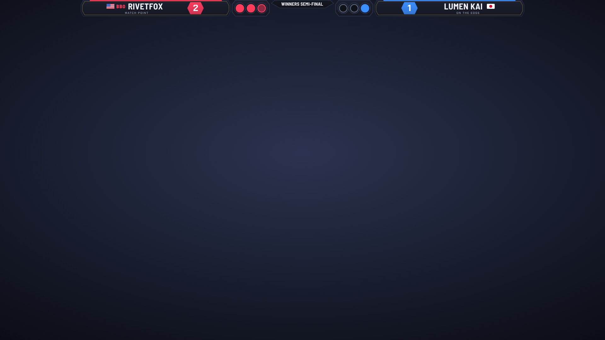

# Layouts

[← BeeboScore Lite guide](../GUIDE.md)

BeeboScore Lite comes with the **Classic** layout for each of its four games. Pick one from the **Layout** menu at the top of the app; with **Settings › Scoreboard › Follow the game** on (the default), changing the game switches to that game's layout by itself.

| Game | Layout | Where the scoreboard sits |
|---|---|---|
| **Tekken 8** | Classic (`tekken8-default`) | Along the top, around the game's round counters |
| **Street Fighter 6** | Classic (`sf6-default`) | Along the top, above the health bars: slanted plates, a slanted set box |
| **Avatar Legends** | Classic (`avatar-default`) | Along the top, above the health bars: Art Deco plates, a round window for each lamp |
| **Fatal Fury: City of the Wolves** | Classic (`fatalfury-default`) | Along the top, above the health bars: comic-book plates and a burst for the set count |

| Tekken 8 | Street Fighter 6 |
|---|---|
|  |  |
| **Avatar Legends** | **Fatal Fury: City of the Wolves** |
|  |  |

Every layout keeps clear of its game's HUD — the health bars, portraits, round counters, timer and meters — on the scoreboard and on every splash.

**Game formats** (Format tab): Tekken 8's Classic has a version for each format (Crew Battle, Team Battle, Gauntlet, Death Battle, Team Death Battle, King of the Hill, League) with the format bar along the bottom, and the app switches to it when a format starts. The other three games run formats on their base layout (the splashes, FullVS and GlassVS), without the format bar.

**In OBS:** one Browser Source with the overlay link from **Stream › OBS** (1920 × 1080, or 2560 × 1440 / 3840 × 2160 — see Settings › Output size). It always shows the layout that's live, so switching layouts never needs a change in OBS.

---

[Install & OBS](install-and-obs.md) · [Running matches](matches.md) · [Game formats](formats.md) · [start.gg brackets](brackets.md) · [Layouts](layouts.md) · [Stream Deck](stream-deck.md) · [Going online](online.md) · [Settings](settings.md) · [Building](building.md) · [Troubleshooting](troubleshooting.md)
