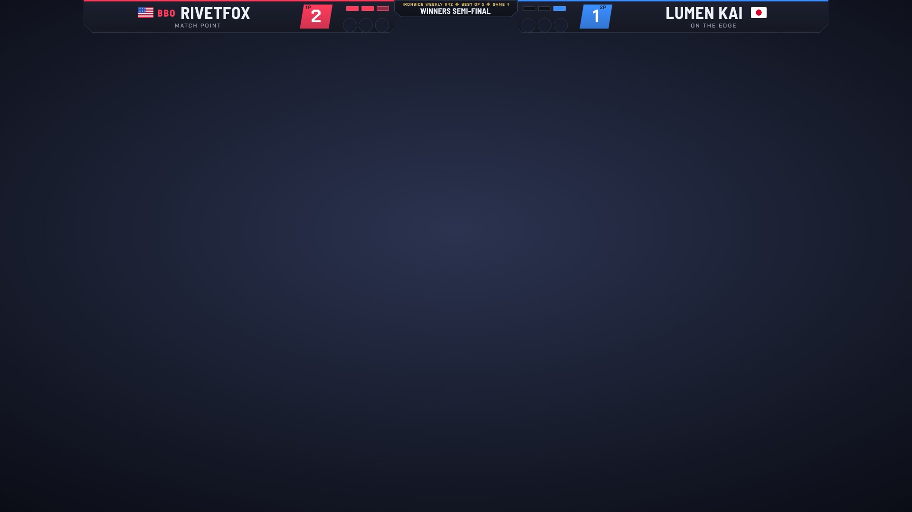

# Layouts

[← BeeboScore guide](../GUIDE.md)

BeeboScore comes with two layouts for each of its four games: **Classic** and **Obsidian Glass**. Pick one from the **Layout** menu at the top of the app; with **Settings › Scoreboard › Follow the game** on (the default), changing the game switches to that game's layout by itself.

Layouts you import (or make) on the **Layouts** tab sit in the same menu, under the game they're for. See [your own layouts](your-own-layouts.md).

| Game | Layout | Where the scoreboard sits |
|---|---|---|
| **Tekken 8** | Classic (`tekken8-default`) | Along the top, around the game's round counters |
| **Street Fighter 6** | Classic (`sf6-default`) | Along the top, above the health bars: slanted plates, a slanted set box |
| **Avatar Legends** | Classic (`avatar-default`) | Along the top, above the health bars: Art Deco plates, a round window for each lamp |
| **Fatal Fury: City of the Wolves** | Classic (`fatalfury-default`) | Along the top, above the health bars: comic-book plates and a burst for the set count |
| **Every game** | Obsidian Glass (`tekken8-obsidian`, `sf6-obsidian`, `avatar-obsidian`, `fatalfury-obsidian`) | In exactly the same places as that game's Classic, in black glass and antique gold |

| Tekken 8 | Street Fighter 6 |
|---|---|
|  |  |
| **Avatar Legends** | **Fatal Fury: City of the Wolves** |
|  |  |

### Obsidian Glass

Black glass and antique gold, built from each game's Classic so it sits in exactly the same places. The lettering is italic, a player's plate cracks as they fall behind (a comeback mends it in gold), heat builds on a streak, and at the end of the set the loser's plate shatters while the winner's turns gold. It moves with a little overshoot. Its own VS, Victory, Top 8, bracket and standings screens are in the same glass with gold embers, and the game-format splashes, FullVS and GlassVS wear it too. Tekken 8's Obsidian Glass has a version for each game format, like Classic.

When **Follow the game** is on, changing the game keeps the look: Obsidian Glass on Tekken 8 becomes Obsidian Glass on Street Fighter 6.

Every layout keeps clear of its game's HUD — the health bars, portraits, round counters, timer and meters — on the scoreboard and on every splash.

**Game formats** (Format tab): Tekken 8's Classic has a version for each format (Crew Battle, Team Battle, Gauntlet, Death Battle, Team Death Battle, King of the Hill, League) with the format bar along the bottom, and the app switches to it when a format starts. The other three games run formats on their base layout (the splashes, FullVS and GlassVS), without the format bar.

**In OBS:** one Browser Source with the overlay link from **Stream › OBS** (1920 × 1080, or 2560 × 1440 / 3840 × 2160 — see Settings › Output size). It always shows the layout that's live, so switching layouts never needs a change in OBS.

---

[Install & OBS](install-and-obs.md) · [Running matches](matches.md) · [Game formats](formats.md) · [start.gg brackets](brackets.md) · [Layouts](layouts.md) · [Stream Deck](stream-deck.md) · [Going online](online.md) · [Settings](settings.md) · [Building](building.md) · [Troubleshooting](troubleshooting.md)
