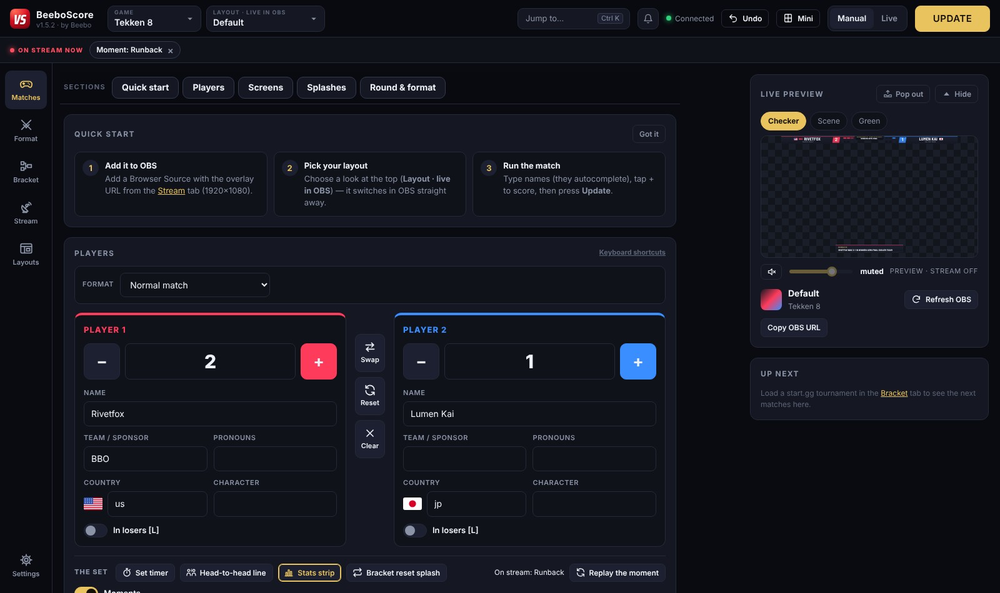
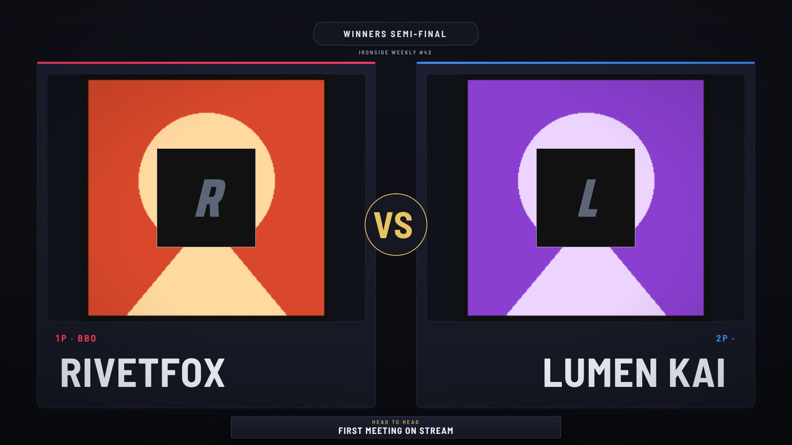
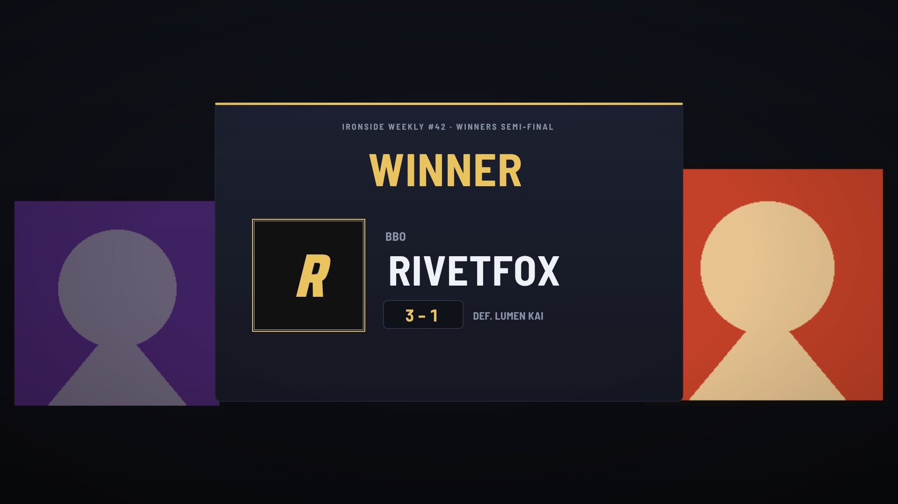
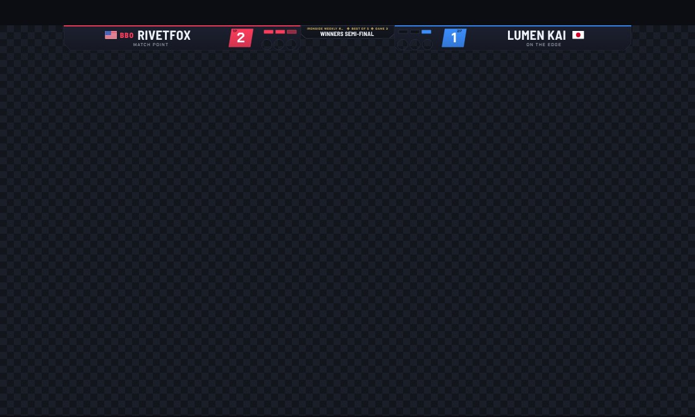

# Running matches

[← BeeboScore guide](../GUIDE.md)

## Running a match

The **Matches** tab is where every match is run.

- **Manual mode:** change anything, then press **UPDATE** (`Ctrl+Enter`). **Live mode:** every change goes out instantly.
- **Scores:** big **+ / −** buttons, or `Q`/`A` (P1) and `P`/`L` (P2) when you're not typing. `Ctrl+Shift+X` swaps sides.
- **Undo** (`Ctrl+Z` or the header button) steps back through the last 50 changes. Fat-fingered a score live? One tap fixes it.
- **Set-over card:** when someone reaches the winning score, a card offers **Load next match** (from your start.gg stream queue / bracket), **Next set** (clear players), **Grand Finals reset** (when the losers-side player takes GF), or just reset scores.
- **Player history:** every set won on the scoreboard is written down on this PC — when, the event and round, both players and their characters, the score and who won. **Matches › Player history** shows the two players on now (their head-to-head, the last time they met, each one's record and most-played characters) and every set kept, newest first, searchable by player or event; **✕** takes a set out again (an exhibition, say). **FullVS** shows the head-to-head under the round (*CrimsonByte leads 3–1 · last time CrimsonByte won 3–2*, or *First meeting*), and any layout can show it with the live values in the Designer's **📜 History** group (`{hist.line}`, `{hist.p1.record}`, `{hist.p1.main}`…). The same set written twice within a minute is kept once; a runback is a new set. Nothing leaves this PC.
- **Caster tools (Matches › Player history):** **📊 Stats card on stream** shows a player's card at the bottom centre — their record, the characters they play and the head-to-head with their opponent — until you press **Hide** (the Stream Deck's **Stats card** key, and the second operator's remote, do the same). It steps aside for full-screen splashes. **Notes** on the two players on now are private (they never go on stream) and are kept per player. **🎙 Open the casters' sheet** (`/casters`, signed in like the panel — handy on a tablet at the commentary desk) shows the round and score, the head-to-head, each player's record, characters and your notes, and what's up next, following the scoreboard live.
- **Victory splash:** a moment after a set is won, the winner takes the whole screen. Turn **Pop up when a player wins the set** on or off, and choose how long it stays up, in **Splashes › Victory** on this tab (also in Settings › Scoreboard). The Splashes card switches between **VS Splash**, **Victory** and **Pictures**.
- **FullVS and GlassVS:** two VS splashes, for any match or format. **FullVS** is the full-screen VS: each player's picture fills their side and the name sits on a plate under it. **GlassVS** is the glass lock-in VS: the two players face to face, each picture whole in its own frame, names under them. Pick which one the **VS button** plays beside it (FullVS / GlassVS) — the choice stays, and the Stream Deck's VS key follows it (hold the key to switch). The Stream Deck XL has a key for each.
- **Colours for each side:** under the VS button, pick a colour for **Player 1** (the left side) and **Player 2** (the right side). FullVS and GlassVS both take them — the slab or card, the frame round the picture and the line under the name — in every look, and they change live while a VS is up. **×** puts a side back to the layout's own colour. In team formats GlassVS keeps the teams' colours.
- **Picture size:** **⤢ Size** (Bracket tab › Splash pictures, or **⤢** beside a format player's picture) sets how big a player's picture is and where it sits, once for FullVS, GlassVS and the PlayerCards. The overlay follows as you move the sliders.
- **VS Splash (FullVS):** one click (or `Ctrl+I`) covers the screen with a player-vs-player splash in the current layout's style, with each player's start.gg profile picture and bracket record (wins – losses in this event). Records refresh every time it opens; you can also type a picture link and record by hand in the **VS Splash** card.
- **Your own VS Splash pictures** (bottom of the **VS Splash** card): upload a **name bar** that sits behind each player's name (best size 920 × 250) and a **header** across the top of the splash (1920 × 200). PNG, WebP or JPG; other sizes are scaled and cropped to fit. They show in every layout. The app looks at the bar where the names sit and picks light or dark lettering, a tint for the team tag and record, and a soft backing when the picture is busy; **Pick my own** swaps that for two colour pickers and warns you if they're hard to read. **Preview** plays the splash in the card.
- **Splash pictures** (Bracket tab): for each player, choose what the VS Splash and the Victory Splash show: their **start.gg profile picture** in the small frame, or a **character image** you upload, shown as a large panel (best size 900 × 1080). After you choose a picture, a window opens where you can **crop** it, **size** it with a slider, **remove the background automatically** (a small model on this PC finds the player or character and takes the rest out — nothing goes online; *Keep* moves the cut, *Edge* softens it) or **remove a green-screen** (or blue-screen) background. It shows how the picture will look on the splash and on a player card. The card shows the two players on the scoreboard; **Find a player** completes names as you type, and the players who already have a character image are in a short list underneath. Pictures are matched by player name, so they follow a player from event to event.
- **Mini controller** (`Ctrl+M` or **Mini** in the header): a small always-on-top window with just names, + / −, Undo, Swap and Reset. Keep it over your game or OBS. Every tap goes straight to stream.
- **Name autocomplete:** start typing in a name box. Matches from start.gg and from players you've used before appear instantly (it also handles partial and out-of-order typing like `lwhg` → LowHigh). Arrow keys + Enter or click to pick; it fills team, country and pronouns too.

### The set as it's told

The scoreboard now tells the story of a set by itself, from the score, the bracket and Player history.

- **Moments.** A short banner comes up bottom centre — between the game's two Heat gauges, just above the commentators — when something worth saying happens:
  - **Match point** (and **Final game** when both players are one game away)
  - **Comeback on** — two or more games down, and level again
  - **Reverse sweep** — won from one game from going out
  - **Sweep** — won without dropping a game
  - **Upset** — the lower seed won (the bracket's seeds; how big the gap must be is in Settings › Scoreboard)
  - **Runback** — the same two players met earlier today
  - **Losers run** — three or more sets won in a row in losers
  - **Bracket reset** — the losers-side player took the first Grand Final set

  One banner at a time, a beat after the score so the point lands first, with a rest between two, and never over a splash — one that comes due while a splash is up waits for it to go. A point taken back takes its banner back too. During a game format the format's own bar tells the story, so the banners rest. Every banner is written in the **show log**.
- **Matches › The set** (the strip under the players): **⏱ Set timer** starts, stops and starts again from zero (**Hide** takes it off the stream); **🤼 Head-to-head line** shows the line from Player history (*CrimsonByte leads 3–1 · last time NeonGhoul won 3–2*, or *First meeting on stream*) in the same place as the banners — it steps aside while a banner is up; **↻ Replay the moment** shows the last banner again; the **Moments** switch turns all of them off for a while.
- **On the scoreboard itself:** a **pip** for every game the set takes (first to 2, 3, 4 or 5 — a longer set keeps just the number), the next one pulsing at match point; **GAME n** in the header's small line; the **set timer** there too when it's on.
- **A swap crosses the two bars** (what's on each one slides across inside its own box, and it no longer counts as a point), and **a new match slides the board out and back** with the new names. Each look does it at its own tempo: Default snaps, Obsidian Glass overshoots and settles, Porcelain eases.
- **Stream Deck:** four keys on a new **Story** page — **Moment banners** on / off, **Replay the moment**, **Head-to-head line** and **Set timer** (tap: start / stop, hold: hide). They're in **Jump to…** (`Ctrl+K`) and in Settings › Keyboard shortcuts as well, and an automation can wait for a moment (*when an upset happens, play the stinger*).

### The splashes tell the story

| FullVS | Victory splash |
|---|---|
|  |  |

- **FullVS in three beats.** The names and pictures come in, the **VS lands with a hit** (a jolt of the screen at Full effects, a smaller one at Light, none at Off or with Less movement), then the **stats strip** comes up along the bottom: each player's **seed** (from the bracket) and **record today** (from Player history), and between them the **head-to-head** — or **Runback** with the earlier score when they met earlier today.
- **GlassVS** has the same strip, just under the glass and clear of the game's Heat gauges, and its pictures drift in a little behind their glass (parallax).
- **Victory** says **where the set sends both players** — *Advances to Winners Final*, *Champion*; *Drops to Losers*, *Eliminated · 5th place* — and how it was won: **Flawless 3–0**, **Reverse sweep**, **Upset** or **Bracket reset**. The loser's art stands behind in grey.
- **The Bracket reset splash.** When the player from losers takes the first Grand Final set, a full-screen splash says so before the second — by itself once nothing else is on screen, for seven seconds (Settings › Scoreboard can switch that off), or with **🔁 Bracket reset splash** in **Matches › The set**. **Hide all** takes it down.
- **Matches › The set** also has **📊 Stats strip** (on or off for every FullVS and GlassVS). Both are in **Jump to…** (`Ctrl+K`), in Settings › Keyboard shortcuts and on the Stream Deck (**Stats strip** and **Bracket reset splash**, on the Story page).

### Live preview

The **Live preview** card on the right shows exactly what OBS shows, over a checkerboard, a game-like scene or green.
- **Pop out** opens it in its own resizable window (right-click it for *Keep on top*), with Transparent / Game / Green / Black backgrounds. Its toolbar fades away when you're not using it.
- **Hide** collapses the card to give the controls more room; **Show** brings it back. The app remembers your choice.
- **Preview volume** (under the preview): how loud your own sounds are *here*. Click the speaker to mute. It never changes the stream, and the preview plays sound even while stream sound is off, so you can try things quietly.
- On smaller screens the preview shrinks so the whole match screen fits.

---

[Install & OBS](install-and-obs.md) · [Running matches](matches.md) · [Game formats](formats.md) · [start.gg brackets](brackets.md) · [Layouts](layouts.md) · [Stream Deck](stream-deck.md) · [Going online](online.md) · [Settings](settings.md) · [Building](building.md) · [Troubleshooting](troubleshooting.md)
