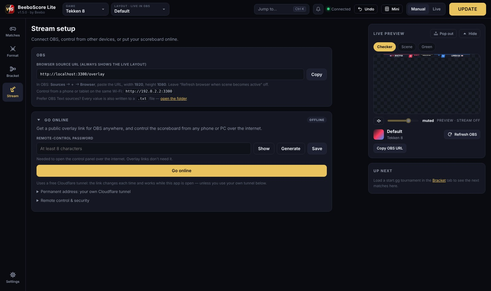

# Going online

[← BeeboScore Lite guide](../GUIDE.md)

## Go online (control remotely)

In the **Go online** card:
1. Set a **remote-control password**.
2. Click **Go online**. The first time it downloads Cloudflare's free tunnel tool (~40 MB).
3. You get two links:
   - **Overlay link:** use it as the Browser Source in any OBS, anywhere (e.g. a co-streamer or a remote production PC). It's safe to share: it only shows the overlay. **Shorten** turns it into a short `is.gd` link (made by the free is.gd link shortener; only the overlay link can be shortened, never the control link).
   - **Remote control link:** open it on any phone, tablet or PC, enter the password, and run the scoreboard from there. It's hidden (dots) so it never shows on stream; **Show** reveals it.

Notes: the links change every time you go online and only work while the app is open on your PC. Quick tunnels have no uptime guarantee. For big events, or a link that never changes, use cloud hosting (below).

### Security

**New installs need the password on your Wi-Fi too.** Phones and tablets on your network can control BeeboScore only with the remote-control password, unless you switch on *Let phones and tablets on my Wi-Fi control the scoreboard without the password* (Stream tab › Security) — fine at home, not at a venue. (Installs that already had it on keep their choice.)

- The overlay link is read-only. Controlling the scoreboard over the internet always needs the password (at least 8 characters; **Generate** makes a strong one).
- Remote devices can run the scoreboard, switch layouts and load matches, but **only the PC running BeeboScore** can change the password, go online/offline, change settings or touch your start.gg token.
- Wrong passwords are rate-limited (lockout after 8 tries), sessions use secure, same-site-only cookies, and other websites you visit can't send commands to the app.
- **Go online › Remote control & security** shows how many devices are signed in, with **Sign out all devices**. Changing the password also signs everyone out.
- Phones and tablets on your own Wi-Fi can control the app without the password. Turn this off in Go online › Remote control & security at public venues with shared Wi-Fi.
- Layouts are HTML pages that run in OBS. Only add layouts from people you trust.

### Permanent address: your own Cloudflare tunnel

Quick online links change every time you go online. With a free Cloudflare account and your own domain you get an address that never changes — handy for the live bracket page file you send people, and for OBS on another PC.

You need a domain that's on Cloudflare (Cloudflare dashboard › **Add a domain**).

1. In the Cloudflare dashboard: **Networking › Tunnels › Create Tunnel**, give it a name, **Create Tunnel**, and pick **Windows**. Copy the install command it shows — **don't run the installer**; BeeboScore runs the tunnel itself and only needs the token inside that command.
2. In BeeboScore: **Stream tab › Go online › Permanent address**. Type the address you'll use (e.g. `bracket.yourdomain.com`), paste the command (or just the long `eyJ…` token) into **Tunnel token**, tick **Use my tunnel when going online**, **Save**, then **Go online**.
3. Back in Cloudflare, the tunnel shows as connected — **Continue**. On the tunnel's **Routes** tab: **Add route › Published application**, the same subdomain and domain, service URL `http://localhost:3300` (`http://localhost:3200` when the app runs from source), **Add route**.
4. Open `https://bracket.yourdomain.com` — it's your scoreboard. That address stays the same every time you go online.

The token is stored encrypted on this PC and never shown again or put in backups.

## Cloud hosting (permanent online address)

Run the scoreboard on a server so the overlay and control panel live at a fixed address like `https://my-scoreboard.onrender.com`. See **[CLOUD-HOSTING.md](../../CLOUD-HOSTING.md)**. It takes about 10 minutes with the included `Dockerfile` / `render.yaml`.

## Short links

Every **Copy link** for a page anyone may see (a layout or one of its screens, the live bracket page) copies a short link like `http://localhost:3300/s/k3Xa9QpL`, which leads on to the full page. They're safe to post publicly:
- only those public pages can have one — never the control panel, the dock or anything that changes the scoreboard;
- the 8-letter code is random and can't be guessed (wrong guesses are slowed down), and it only ever leads to a page of your own BeeboScore;
- a live bracket page's short link stops working when the page's own link closes;
- the same page always gets the same code, so a link already in OBS keeps working.

The Cloudflare part of an online address (`something-something.trycloudflare.com`) is chosen by Cloudflare and changes every time. For a short address that never changes, use your own tunnel (*Permanent address* above), or **Shorten** for the overlay link.

---

[Install & OBS](install-and-obs.md) · [Running matches](matches.md) · [Game formats](formats.md) · [start.gg brackets](brackets.md) · [Layouts](layouts.md) · [Stream Deck](stream-deck.md) · [Going online](online.md) · [Settings](settings.md) · [Building](building.md) · [Troubleshooting](troubleshooting.md)
