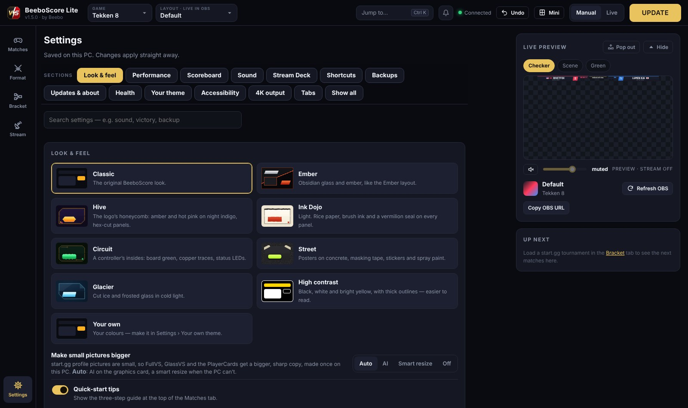
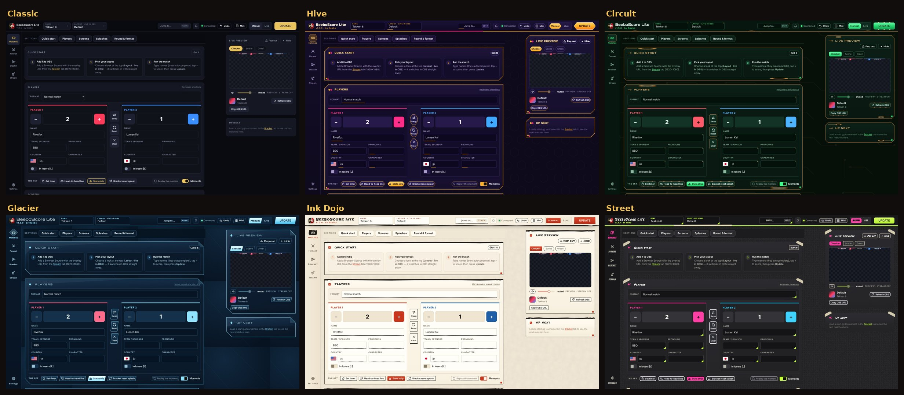

# Settings, backups & self-test

[← BeeboScore Lite guide](../GUIDE.md)

## Settings

**Settings** is split into cards with jump links at the top:

- **Look & feel:** pick the app's theme: **Classic** (the original look), **Ember** (matches the overlay: obsidian glass, ember edges, chrome titles), or one of five more themes: **Hive** (honeycomb: amber and hot pink on night indigo), **Ink Dojo** (rice paper, brush ink and a vermilion seal), **Circuit** (board green, copper traces and a status LED), **Street** (posters on concrete, masking tape, stickers and spray paint) and **Glacier** (cut ice and frosted glass). Their panels, buttons, tabs, fields and ornaments are Designer drawings, and every dropdown opens as a themed list (type to filter long lists; ↑ ↓ Enter Esc work too). **Jump to…** (`Ctrl+K` or the search bar in the header) finds any tab, panel or action, including the themes. Also: animate the live preview, show the quick-start tips, and **Potato mode**.

  

- **Scoreboard:** *Follow the game* (switch layouts when you change the game), *Refresh OBS on reset and new match* (waits for the bars to play their own way back, never under a splash or during a game format; the fresh copy fades in), and *Lock-in splash in team formats*.
- **Scoreboard — the set as it's told:** *Count the games in the header* (GAME 3), *Time every set* (the set timer starts by itself with the first point and stops at the win; off, it only runs when you start it), and **Moment banners** — one switch for all of them, a switch for each (match point, comeback, reverse sweep, sweep, upset, runback, losers run, Grand Final reset; *a game is won* is the flash and the pip, not a banner) with **▶ Try** to see that banner on stream with the players on now, and **how many seeds apart** an upset needs (from 2 to 16; 4 to start with). See [Matches](matches.md#the-set-as-its-told-11221).
- **Scoreboard — the splashes:** *Stats strip on FullVS and GlassVS* (each player's seed and record today, and the head-to-head or a runback between them) and *Bracket reset splash* (it comes up by itself after the reset; off, only when you put it up). Both on to start with.
- **Sound:** stream sound on / off for your own sound files (**off by default**), the stream volume or **Let OBS set the level**, the OBS dock link and **Check OBS** for audio (see [Sound](#-sound)).
- **Colours on stream** (Scoreboard): **Team colours** (teams, and players with a team colour, show their colours on the bars, PlayerCards and splashes) or **Layout's own** (everything stays in the layout's theme colours, FullVS and GlassVS included, in any match, not only in team formats; the VS side colours on the Matches tab then step aside, and a note there says so). The control panel itself always keeps its own colours, so it stays readable whatever colours the teams pick.
- **Make small pictures bigger** (Look & feel): start.gg profile pictures are small, so the app makes a bigger, sharp copy of each one once, on this PC, for FullVS, GlassVS and the PlayerCards. **Auto** uses an AI upscaler on the graphics card (a few seconds per picture, offline) and a smart resize (instant) when the PC has no graphics acceleration or runs in potato mode; or pick **AI**, **Smart resize** or **Off**. The copies are kept with the picture cache.
- **OBS connection**: the address and password of OBS's WebSocket server (OBS › Tools › WebSocket Server Settings), for **Check OBS** (sound) and for adding the overlay to OBS at the right size
- **Stream Deck:** app and plugin status, install / update, automatic plugin updates.
- **Keyboard shortcuts:** click any shortcut and press a new key or combination (`Esc` cancels, `Backspace` clears). Optional shortcuts can be set for **Reset scores**, **Victory splash**, **Bracket splash**, **Top 8 splash**, **Refresh bracket**, **Bracket side** and **Stream sound on / off**. The mini controller follows the same shortcuts. (The **Keyboard shortcuts** link on the Players card jumps here.)
- **Updates & about:** the version, the release notes and **Check for updates**: it fetches a newer BeeboScore Lite exe into the same folder, and **Restart & update** switches over to it (see [Updates](install-and-obs.md#updates)). A Testbuild or an installer build doesn't update itself.

- **Search settings** at the top finds any setting by a word (sound, victory, backup…). `Esc` clears it.
- **Settings** shows one section at a time: Look & feel, Performance, Scoreboard, Sound, Stream Deck, Shortcuts, Backups, Updates & about, Health, Your theme, Accessibility, 4K output and Tabs — or **Show all**.
- **Laptop mode** (Performance, 1.12): for a laptop that also runs the game or OBS. Effects draw at 30 frames a second and at the lighter size. When nothing has changed on the scoreboard for 20 seconds, the looping effects (glows, pulses, the comet, embers) rest; they pick up again at the next point, splash or name change.
- **Effects engine** (Performance): how BeeboFX, the app's GPU effects engine, draws the layouts' effects. **Auto** (the default) starts at full quality and steps down by itself if frames run long, all the way to Ultra-light; **Full**, **Light** (lower resolution, fewer particles), **Off** (the simpler CSS effects) or **Ultra-light** (1.11, for very weak PCs: no glows, blurs or looping effects, no particles on the splash screens, the engine off, and entrances and transitions that only slide, scale and fade). Auto picks Ultra-light by itself on a PC without a graphics card, or when the layout can't hold about 25 frames a second. The **Stream · Effects quality** Stream Deck key changes it from the deck. **BeeboFX 3** (the materials, lettering, backdrops and fluids drawn on the graphics card) has its own watchdog on **Auto**: if its frames run long on stream it first draws smaller, then stands aside for the plain look, and tries again later. Under the setting, **In OBS now** shows how hard it's working on your stream PC (frames a second and milliseconds a frame: under 6 ms is a light load, over 14 ms heavy) and says when it stepped down and why.
- **Light effects** (Look & feel): every animation stays, the heaviest extras go — embers, glows, screen shakes, background lightning, blurs. For PCs that drop frames in OBS; in between full effects and potato mode, and it switches live without a restart.
- **App window frame rate** (Performance): how often the app's own window — the live preview — redraws: **60** (the default), **30**, or **as fast as the screen**. On a 144 or 240 Hz monitor it would otherwise draw two to four times the frames your stream needs, on the graphics card the game and OBS are using. Overlays in OBS always follow OBS's own frame rate (set the browser source's frame rate to your stream's, or leave *Use custom frame rate* off). Kept on this PC.
- **Health** (its own chip; and what's worth changing): everything at a glance, green, amber or grey — the overlays open (which layout, on this PC or a viewer's, and how their effects engine is coping), OBS, the Stream Deck, the last backup, a data file that had to be **recovered** from its last good copy, and the app (version, how long it's been running, memory, sets in Player history, the tempo). **Refresh** checks again, and (with Settings › OBS connection) looks at OBS too: your stream's frame rate and every BeeboScore browser source in it. It then points out what's worth changing — **several BeeboScore sources** (each is a whole browser of its own, running all the time: one `/overlay` source is usually enough), a source **drawing more frames than your stream**, one set to **refresh when its scene becomes active** (it replays its intro every time), one **not at 1920 × 1080**, and an overlay that had to **step down to the plain look** to keep up. also FFmpeg (found, and its version), the backup PC, sync between your PCs, and whether the music player, the vertical scoreboard and the venue screen are in OBS — each with **Add to OBS**, which never adds the same source twice.
- **Run the first-time setup again** (Updates & about): the four-step guide a new install opens with — pick a look, add it to OBS (it tells you when OBS is showing it), pick start.ggrnament.

### Safer saving

Every save of the app's own files (settings, the scoreboard, players, teams, formats) is written to a new file first and swapped in only once it's complete, so a crash or a power cut mid-save can't leave a half-written file. The copy before it is kept as `<file>.bak`. If a file can't be read when the app starts, the app uses that last good copy instead and **Settings › Health** says so (*Recovered*).

### Backups

**Settings › Backups** keeps everything you set up: settings and keyboard shortcuts, players, saved teams and the picture library.

- **Download a backup** saves one `.beebo-backup` file. **Restore from a backup…** reads it, shows what's in it, backs up your current setup first, restores, and restarts the app.
- **Passwords and sign-ins are never in a backup:** the OBS WebSocket password, start.gg sign-ins, your remote-control password and your Cloudflare tunnel token stay on this PC. After restoring on another PC, sign in again there.
- **Automatic backups:** once a day (when the app is running), into the backups folder (**Open the backups folder**). The last 7 are kept.
- Moving from the portable Beta to the installed Beta (or the other way round): they keep separate data, so take a backup in one and restore it in the other.

### Self-test

**Settings › Updates & about › Run the self-test** checks what only your PC can answer: saving files, the encrypted sign-ins (Windows protection or the app's own AES-256 key), saving the standings picture (it shows you a test picture), potato mode, whether OBS is showing the overlay, going online, start.gg and Twitch. **Copy the results** to paste them when asking for help. Nothing is changed. It also checks folders with accents (`Ñandú`, `東京`), warns when the data folder is inside OneDrive, and checks that phones on your Wi-Fi can reach this PC (Windows Firewall).

From a command line: `"BeeboScore Lite.exe" --self-test=result.json` runs the same checks without opening a window and exits with 0 when everything passed (used by the Windows check on GitHub, `.github/workflows/windows-check.yml`).

### Sound

The Classic layouts make **no sound of their own**; the Sound card is for any sounds a layout adds (stream sound on / off, the volume, or *Let OBS set the level*).

- **Everything starts muted.** Stream sound stays off until you turn it on (Settings › Sound, a shortcut, the Stream Deck **Stream sound** key or the OBS dock). The live preview stays muted until you unmute it with its .
- **How it reaches your stream:** the layout is a browser source, and with **Control audio via OBS** ticked on that source its sound becomes an audio source in the OBS mixer, like a mic or game capture. You get a fader, mute, filters and monitoring for it, and it goes out on stream and in recordings. Without the tick, OBS plays it on your desktop speakers instead and the stream never hears it. **Check OBS** (Settings › Sound) finds every BeeboScore source and ticks it for you.
- **Who sets the level:** by default the **stream volume** in Settings sets one level for every layout. Turn on **Let OBS set the level** and your sounds go out at full level, so the source's fader in the OBS mixer is the only control.
- **Control it from inside OBS:** **Copy dock link**, then in OBS go to **Docks › Custom Browser Docks…**, name it *BeeboScore*, paste the link and press Apply. You get a BeeboScore panel inside OBS: sound on / off and volume, the scores, the VS and victory splashes, the format bar, and (when a bracket is loaded) the Bracket, Top 8 and Standings splashes plus **Post bracket link** to Twitch chat.
- **Preview volume** (under the live preview) only changes what you hear in the app.
- A second source that shouldn't make noise: add `?sound=0` to its OBS link. Screen links (`?screen=`) are always silent; the main layout plays.
- Your own HTML layout can play its own files with `BeeboSound.file('/assets/your-sound.mp3', 0.8)` (the second number is that file's level, 0 to 1). It follows the stream switch and volume.
- No sound in Potato mode (the layout is a still picture).

### Potato mode

Restarts the app in a lightweight mode for very low-end PCs: a classic Windows XP look with no animations or effects, graphics acceleration off, and layouts drawn as a still PNG after each change instead of animating. For the lightest OBS setup, add an **Image** source pointing at `output/overlay.png` (OBS picks up every change by itself). Switch it off the same way. Potato mode takes priority over the app theme.

---

[Install & OBS](install-and-obs.md) · [Running matches](matches.md) · [Game formats](formats.md) · [start.gg brackets](brackets.md) · [Layouts](layouts.md) · [Stream Deck](stream-deck.md) · [Going online](online.md) · [Settings](settings.md) · [Building](building.md) · [Troubleshooting](troubleshooting.md)
- **Tabs on the left**: hide the tabs you don't use and put the rest in your own order, on this PC. Settings always stays at the bottom, and Jump to (Ctrl+K) still opens a hidden tab.
- **High contrast** (Look & feel): black, white and bright yellow with thick outlines. The panel also follows the computer's own *reduce motion* setting.
- **Less movement** (Accessibility; the stream too): no sliding or fading in the panel, and on stream the scoreboard and its banners fade instead of sliding and slamming, the match-point pip is marked instead of pulsing, and the effects engine rests (no rings, sparks, embers or shakes).
