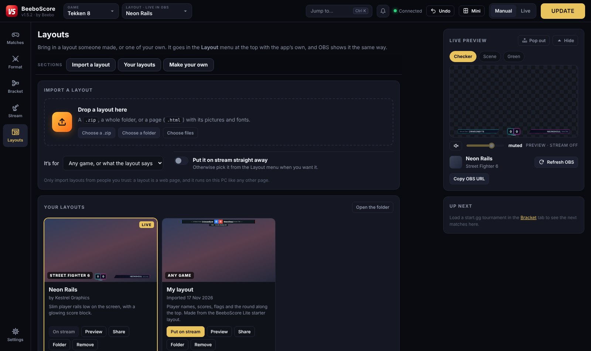
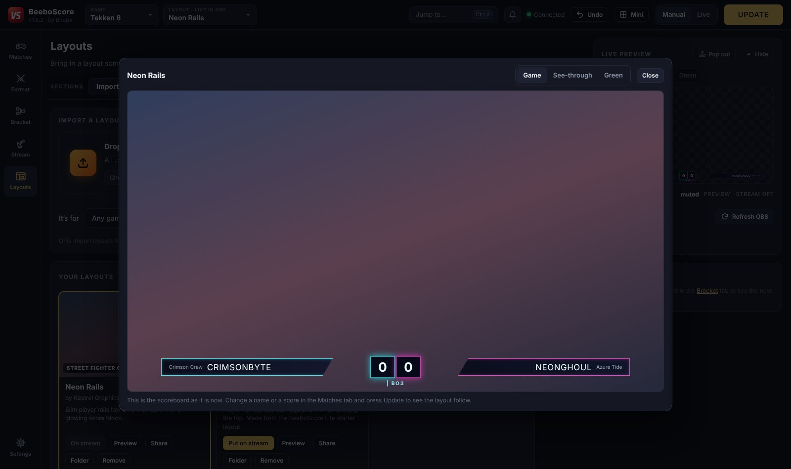

# Your own layouts

[← BeeboScore guide](../GUIDE.md)

The **Layouts** tab brings in layouts other people made, and ones you make yourself. An imported layout goes in the **Layout** menu at the top of the app with the app's own, and OBS shows it the same way: same OBS link, same Update button.



## Importing a layout

Drop it on the **Layouts** tab, or use **Choose a .zip**, **Choose a folder** or **Choose files**. Any of these works:

- **A `.zip`** the creator sent you. If everything is inside one folder in the zip, that's fine.
- **A folder** with the layout's page (`index.html`) and its pictures, fonts and styles.
- **A page** (`.html`) on its own, or with the files it uses.

Before you import:

- **It's for:** the game the layout goes under in the Layout menu. Leave it on *Any game, or what the layout says* and the layout's own `overlay.json` decides, or it goes under **Any game**.
- **Put it on stream straight away:** on, and the layout goes live as soon as it's in.

Good to know:

- The page OBS shows has to be called `index.html`. If there's only one page, BeeboScore uses it whatever it's called. If there are several, it asks you to name one `index.html`.
- Only the files a web page uses come in: pages, styles, scripts, pictures, fonts, video, sound and 3D models. Anything else (a program, a shortcut) is left out, and the app tells you which.
- Already have a layout with that name? You're asked whether to **replace it** or **keep both**.
- A layout can't take the name of one of the app's own layouts, so the app's layouts are never replaced.
- If the layout doesn't use any `data-sb` bindings or the scoreboard events, the app tells you: names and scores won't change on it. That's fine for a picture-only screen, like "starting soon".
- A zip can be up to 70 MB.

> [!WARNING]
> Only import layouts from people you trust. A layout is a web page, and it runs on your PC like any other page.

Imported layouts are kept in the `overlays` folder of your **BeeboScore Lite Data** folder, so they survive updates and are part of your backups.

## Your layouts

Each layout you've imported gets a card with a live picture of it.

- **Put on stream:** makes it the live layout. (The Layout menu at the top does the same.)
- **Preview:** the layout at full size with the scoreboard as it is now, over a game-like background, a see-through checkerboard or green.
- **Share:** saves it as a `.zip` to send to someone. They import it the same way.
- **Folder:** opens its folder, to change the files. OBS and the preview pick up a saved change by themselves.
- **Remove:** takes it out of the Layout menu. If it was live, the app's own layout for the game goes on stream. A copy is kept in your data folder under `data\removed-layouts`, so you can bring it back by importing that folder.



### Layouts from BeeboScore 1.4.0

Ember, Porcelain and layouts you made in 1.4.0's Overlay maker aren't built in any more, but they come back this way. Open your `BeeboScore Data\overlays` folder (next to the old exe), and drop the layout's folder (for Ember, the one called `shattered`) on the **Layouts** tab.

## Making your own

A layout is a web page the size of your stream, 1920 × 1080, with a see-through background. BeeboScore adds its overlay client to the page by itself; you only mark the parts that change.

**Download the starter layout** on the Layouts tab. It's a finished scoreboard (names, scores, flags, games won and the round along the top) with every part explained inside. Change it, zip the folder and import it.

```html
<span data-sb="p1.name"></span>              <!-- player 1's name -->
<b data-sb="p1.score"></b>                   <!-- their score -->
<span data-sb="{round} | {event}"></span>    <!-- several fields at once -->
<i data-sb-show="p1.loser">[L]</i>           <!-- only there when they're in losers -->
```

### Bindings

| Binding | What it does |
| --- | --- |
| `data-sb="p1.name"` | Puts the field's text in the element |
| `data-sb="{p1.team} \| {p1.name}"` | A template with several fields |
| `data-sb-src="img/{p1.characterSlug}.png"` | A picture, hidden when the file is missing |
| `data-sb-bg="p1.flagUrl"` | A background picture |
| `data-sb-show="p1.team"`, `data-sb-hide="p1.loser"` | Shown (or hidden) when the field has something in it; `!p1.loser` turns it round |
| `data-sb-class="lead:p1.leading"` | Adds the class `lead` while the field is true |
| `data-sb-pips="p1"` | One `<i class="pip">` per game needed to win; games won get the class `on` |
| `data-sb-fit="40,22"` | Shrinks the text (40px down to 22px) until it fits its box |
| `data-sb-scored="p1"` | Gets the class `sb-scored` for a moment when player 1 takes a game |

### Fields

- `p1` and `p2`: `name`, `team`, `pronouns`, `country`, `flagUrl`, `flag` (the emoji), `character`, `characterSlug`, `score`, `loser`, `displayName` (the name with [L]), `fullName` (team \| name), `leading`, `winner`, `matchPoint`, `loserTag`.
- The match: `round`, `event`, `game`, `bestOf`, `bestOfText` ("Best of 3"), `bestOfShort` ("BO3"), `firstTo`, `firstToText`, `isGrandFinals`, `setOver`, `winnerSide`, `finalGame`.
- Commentators: `c1.name`, `c1.handle`, `c2.name`, `c2.handle`, `commentators` (both names).

### Classes on `<html>`

`sb-ready`, `sb-p1-winner`, `sb-p2-winner`, `sb-p1-matchpoint`, `sb-p2-matchpoint`, `sb-final-game`, `sb-p1-loser`, `sb-p2-loser` and `sb-gf` (grand finals). An element whose value just changed gets `sb-changed` for a moment, which is handy for a little animation.

### Scripting

```js
window.addEventListener('scoreboard', e => console.log(e.detail));          // the whole scoreboard, on every update (e.detail.prev is the one before)
window.addEventListener('scoreboard:scored', e => console.log(e.detail.side)); // 1 or 2
window.addEventListener('scoreboard:set-over', e => console.log(e.detail.winner));
```

### The layout's details

An `overlay.json` next to the page names the layout and the creator:

```json
{ "title": "Neon Rails", "author": "Kestrel Graphics", "game": "Street Fighter 6", "description": "Slim player rails low on the screen." }
```

`game` is one of `Tekken 8`, `Street Fighter 6`, `Avatar Legends`, `Fatal Fury: City of the Wolves`, or left out for any game. A `thumb.png` (or `.webp`, `.jpg`) next to the page becomes its picture on the Layouts tab.

### Tips

- Use relative paths for your files (`img/logo.png`, `fonts/mine.woff2`): the page is served from its own folder.
- Keep the background see-through: `html, body { background: transparent; }`.
- To try changes quickly, import the layout once, then press **Folder** on its card and change the files there. Every time you save, OBS reloads it.
- Layouts made in BeeboScore's Layout Designer (`.beebo` files) import too.
