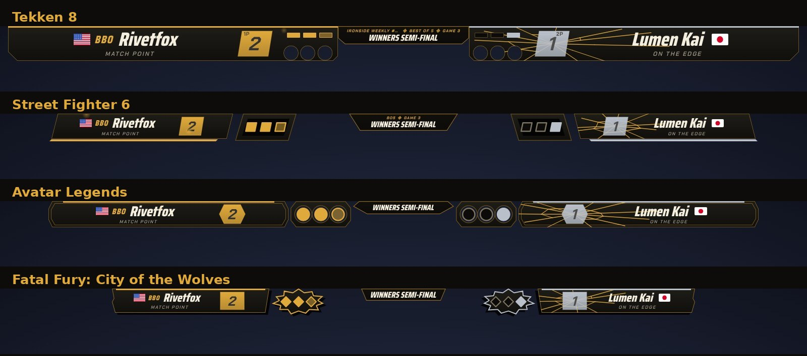

## BeeboScore 1.5.4

**Download `BeeboScore-1.5.4.exe`** below. Already on BeeboScore? Open **Settings → Check for updates** and it fetches this one for you. (The `BeeboScore-Lite-1.5.4.exe` file is the same app, named so 1.5.0 can find it.)

### New: Obsidian Glass for every game

- A second layout for Tekken 8, Street Fighter 6, Avatar Legends and Fatal Fury: **Obsidian Glass**, in black glass and antique gold. Pick it from the **Layout** menu.
- It sits in exactly the same places as Classic, so it stays clear of each game's HUD.
- Plates crack as a player falls behind and shatter on the loser at the end of the set; the winner's turns gold.
- Its VS, Victory, Top 8, bracket, standings and game-format splashes are all in the same glass, and Tekken 8's has every game format.
- With **Follow the game** on, changing the game keeps the look you're on.

The full list of changes is in [CHANGELOG.md](https://github.com/t1fgc/beeboscore/blob/main/CHANGELOG.md).

### Windows SmartScreen

The first time you run the exe, Windows may say **"Windows protected your PC"**. Click **More info**, then **Run anyway**. Only do this for a copy downloaded from this Releases page.
