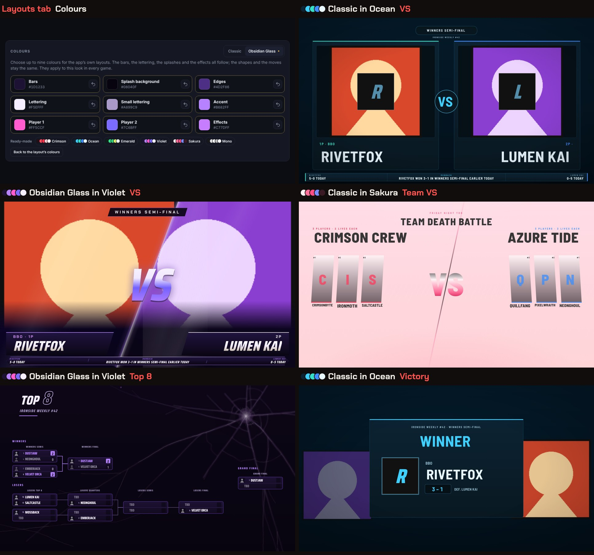

## BeeboScore 1.5.5

**Download `BeeboScore-1.5.5.exe`** below. Already on BeeboScore? Open **Settings → Check for updates** and it fetches this one for you. (The `BeeboScore-Lite-1.5.5.exe` file is the same app, named so 1.5.0 can find it.)

### New: your own colours for the app's layouts

- Open the **Layouts** tab and use the new **Colours** card to give Classic or Obsidian Glass up to nine colours of your own.
- The bars, the splash backgrounds, the edges, the lettering, the accent, both players' colours and the effects all follow, on the scoreboard and on every splash.
- The shapes, the lettering style and the moves stay the same, so each layout keeps its feel.
- Start from one of six ready-made sets (Crimson, Ocean, Emerald, Violet, Sakura and Mono), change one part at a time, or go back to the layout's own colours with one press.
- Each look keeps its own colours, in all four games. OBS picks up a change by itself.

The full list of changes is in [CHANGELOG.md](https://github.com/t1fgc/beeboscore/blob/main/CHANGELOG.md).

### Windows SmartScreen

The first time you run the exe, Windows may say **"Windows protected your PC"**. Click **More info**, then **Run anyway**. Only do this for a copy downloaded from this Releases page.
