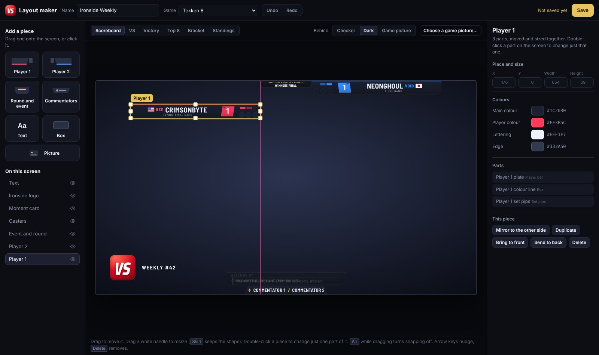

## BeeboScore 1.5.6

**Download `BeeboScore-1.5.6.exe`** below. Already on BeeboScore? Open **Settings → Check for updates** and it fetches this one for you.

### New: the layout maker

- Make your own layout by dragging pieces onto the screen. Open the **Layouts** tab and pick **Start from Classic**, **Start from Obsidian Glass** or **Start empty** under **Make your own**.
- Add player bars, the round, the commentators, text, boxes and pictures. Move them, with snapping to the middle and to the other pieces, and resize them with the handles.
- Click a piece to change its colours, font and size, or the words it shows. The whole layout's colours work like the Colours card, with the same ready-made sets.
- The VS, Victory and Top 8 screens come with it, and you can change those the same way.
- Put a screenshot of your game behind it to line it up with the game's health bars.
- **Save** puts it in the Layout menu, with a version for each game format. **Edit** on its card opens it again.

Writing a layout in HTML is still there for creators, under **Build one by hand instead**.

The full list of changes is in [CHANGELOG.md](https://github.com/t1fgc/beeboscore/blob/main/CHANGELOG.md).

### Windows SmartScreen

The first time you run the exe, Windows may say **"Windows protected your PC"**. Click **More info**, then **Run anyway**. Only do this for a copy downloaded from this Releases page.
